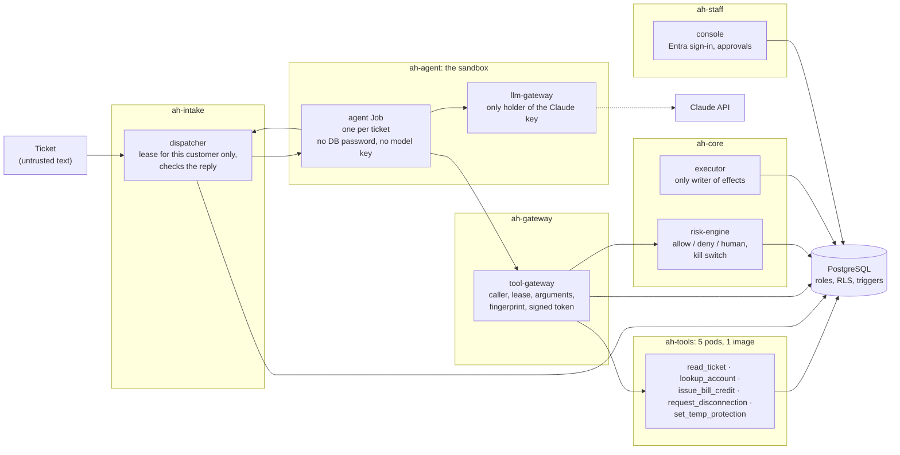

# assume-hijacked

An AI support agent for a fictional electricity supplier, built on one assumption: the model is already hijacked.

The agent can ask for a bill credit, a move-out or a temporary protection flag. It cannot choose whose account a tool reads, write an effect, approve its own request or see medical flags, because the network, the identities and the database refuse it, whatever the model says. Risky requests are scored by a separate risk engine and wait for a human. The tests attack the walls with a scripted model that does whatever a ticket tells it; they do not measure how well a real model resists prompt injection.

All customer data is fictional. v1 of this project (Docker Compose, 17 services, five threat frameworks) is kept as the git tag `v1`. v2 is the same idea with the parts that did not add a wall removed.

## Architecture



Nine parts, each with one job: dispatcher, agent, llm-gateway, tool-gateway, risk-engine, tools, executor, console, PostgreSQL. The tools are five pods from one image; each logs in as its own database role and can run one SQL function. Details, allowed edges and the permission table are in [docs/architecture.md](docs/architecture.md).

The same Helm chart runs on kind (local, free) and on AKS. Cilium network policies default-deny every namespace and allow one rule per edge. Admission policies accept only images pinned by digest and only the agent Job from its template.

## OWASP Top 10 for Agentic Applications 2026

The attack tests are named after the [OWASP Agentic Top 10](https://genai.owasp.org/) ids (`test_asi03_same_approver_twice`). After a test run pytest prints one line per id. The full table with every test name, and every other wall with its test, is in [docs/attacks.md](docs/attacks.md).

| ASI | Attack | Wall that stops it | Test file (under `tests/`) |
|---|---|---|---|
| ASI01 Agent Goal Hijack | Read another customer's account | The agent drops the id; lease-scoped DB function; row-level security | `attacks/test_asi01_read_another_customer.py` |
| ASI01, ASI02 | Disconnection at a protected home | Risk tier HUMAN_ONLY; DB trigger refuses the order | `attacks/test_asi01_disconnection_at_a_protected_home.py` |
| ASI02 Tool Misuse | Credit too big, negative, or with no real charge | Risk tier and approvals; DB trigger | `attacks/test_asi02_credit_too_big_or_unbacked.py` |
| ASI02 | Protection flag YES to NO | Tools can only add flags; no role can change one | `attacks/test_asi02_protection_flag_yes_to_no.py` |
| ASI02, ASI03 | Data out (internet, DNS), reach the DB or a tool directly, ask the metadata endpoint for a token | Default-deny policies (Cilium); signed token per call; metadata address denied | `attacks/test_asi03_reach_a_tool_directly.py`, `k8s/test_walls.py`, `k8s/test_chart.py` |
| ASI03 Identity & Privilege Abuse | Medical flag reaches the model | No tool returns it; only the executor role reads flags | `attacks/test_asi03_medical_flag_never_reaches_the_model.py` |
| ASI03 | Same person approves twice | Approvals only in the console; the database counts distinct people | `attacks/test_asi03_same_approver_twice.py` |
| ASI04 Agentic Supply Chain | Unpinned or swapped image; changed tool description | Admission by digest; gateway fingerprint | `attacks/test_asi04_changed_tool_description.py`, `k8s/test_walls.py`, `k8s/test_chart.py` |
| ASI06 Memory & Context Poisoning | Next ticket sees the previous ticket's data | One Job per ticket, no memory, lease bound to the pod | `k8s/test_replay.py` |
| ASI08 Cascading Failures | Risk engine down or too slow | The gateway fails closed | `attacks/test_asi08_risk_engine_down.py` |
| ASI09 Human-Agent Trust Exploitation | A reply that promises money | Reply guard in the agent and again in the dispatcher; no approve tool | `attacks/test_asi09_reply_that_promises_money.py` |
| ASI10 Rogue Agents | The agent keeps calling denied tools | Three denials pause all agents; a SeniorApprover resumes | `attacks/test_asi10_kill_switch.py` |

ASI05 (Unexpected Code Execution) and ASI07 (Insecure Inter-Agent Communication) are not applicable: the agent runs no code and there is one agent. See [docs/attacks.md](docs/attacks.md).

## Run it on kind

Needs Docker Desktop (about 6 GB), `kind`, `kubectl` and `helm`. Run the scripts from the repository root with a POSIX shell (Git Bash on Windows).

```sh
sh scripts/kind-up.sh            # cluster "ah": kind, Cilium, Hubble, local registry
sh scripts/kind-deploy.sh        # build the image, push it, helm install by digest
sh scripts/kind-monitoring.sh    # Prometheus, Grafana, Alertmanager, Mailpit, the Walls board
sh scripts/new-ticket.sh 1001 "I was charged twice, please check."
```

`new-ticket.sh <customer_id> "<text>"` files a ticket in the cluster database and prints its id; the dispatcher picks it up and starts an agent Job. Customers 1001 to 1003 are seed data. The model is the scripted one (`llm.backend: scripted` in the chart values). The `anthropic` backend (Claude Haiku) exists but has not been run; it needs a key and costs money. Staff sign in to the console with the dev identities listed in `deploy/helm/assume-hijacked/values-kind.yaml`.

Tests:

```sh
cp .env.example .env             # then change the passwords
sh scripts/test-db.sh start      # PostgreSQL in Docker on 127.0.0.1 (port from DB_PORT in .env)
python -m pytest -q              # unit tests, attack tests, chart render tests
python -m pytest -m k8s tests/k8s  # network, admission and replay tests against the cluster
```

`sh scripts/kind-down.sh stop` frees memory and keeps the cluster; `sh scripts/kind-down.sh` deletes it. Alerts and how to react to them: [docs/runbook.md](docs/runbook.md).

## CI

GitLab CI has three jobs.

| Job | Does |
|---|---|
| lint | ruff, gitleaks, `terraform fmt` and `validate`, `helm lint` |
| test | the default pytest run against a PostgreSQL service, including the chart render tests (`helm template`, then the network and admission objects, no cluster) |
| build | the app image and a Trivy scan |

CI does not run dispatcher, agent, gateway and tools together, and it does not start a cluster (the free minutes would not last). The network and admission attacks and the end-to-end run happen on kind. Terraform plan, apply and the Helm deploy to AKS are designed at the Azure step and are not in the pipeline yet.

## Repository

| Path | Content |
|---|---|
| `app/` | all Python, one image |
| `permissions/` | one capability manifest per part; Terraform, the chart and the gateway read them |
| `tests/` | `unit/`, `attacks/` (named by ASI) and `k8s/` |
| `db/` | schema, roles, grants, seed, `init.sh` |
| `deploy/` | Helm chart, monitoring values and dashboard, kind config |
| `infra/` | Terraform: `base/`, `lab/`, `modules/` |
| `scripts/` | test database, kind, deploy, new ticket |
| `docs/` | [architecture](docs/architecture.md), [attacks](docs/attacks.md), [azure](docs/azure.md), [runbook](docs/runbook.md) |

Monitoring is two alerts (executor stopped, kill switch fired) and one Grafana board, "Walls".

## What is verified

Verified means it ran and the output was read.

- **Test suite.** The default `pytest` run is green: 330 passed, 170 deselected (the deselected ones need a kind cluster). It runs against a real PostgreSQL, so the database walls are tested as the database enforces them.
- **Images.** The application image and the attack-suite image both build.
- **kind run.** Pending; the deployed stack and the kind tests have not been run on v2 yet.

<!-- filled after the kind run -->

Not verified, and not claimed:

- **Azure.** The Terraform in `infra/` has `terraform test` files that use mock providers and CI runs `terraform validate`; nothing has been applied. No Azure resource exists for this project, and nothing billable has been started.
- **Real Entra sign-in.** The console's Entra code has unit tests for tokens with the wrong audience or issuer. A browser login against a real tenant has not happened. On kind the console uses dev identities.
- **Kata.** On kind the `kata-vm-isolation` RuntimeClass is backed by runc, so there is no micro-VM there. AKS pod sandboxing is configured in Terraform and untested.
- **Real model.** No test calls a paid API. A real Claude run on a ticket needs a key and a decision from the owner.
- **Hubble drop panel on AKS.** It depends on the outbound-control decision in [docs/azure.md](docs/azure.md).
