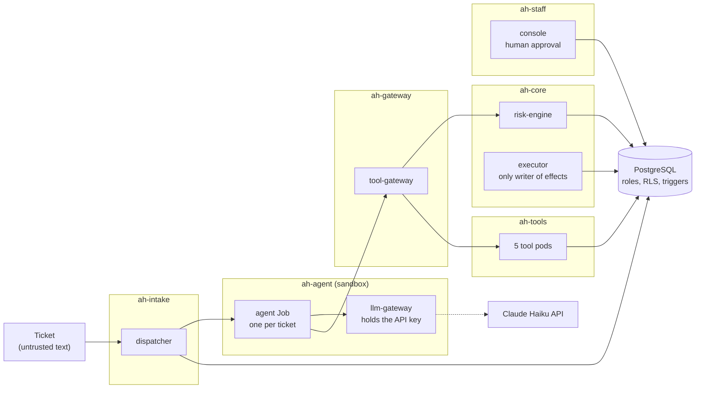

# assume-hijacked

An AI support agent for a fictional electricity supplier, built on one assumption: the model is already hijacked. The walls around it (network, identities, database) do not depend on what the model says.

Azure deployment: Terraform and CI are ready; first live run in progress.

Demo video (2.5 min, the real app on kind): [docs/demo.mp4](docs/demo.mp4). Real Claude Haiku answers a normal question and refuses a direct injection on its own; then a fully hijacked model sends five attacks and the walls stop all five; Grafana shows the same events as metrics.

## The idea

The agent can ask for a bill credit, a move-out or a temporary protection flag. It cannot choose whose account a tool reads, write an effect, approve its own request or see medical flags. The network, the identities and the database refuse it, whatever the model says. Risky requests are scored by a separate risk engine and wait for a human.

The tests attack those walls with a scripted model that obeys every order in a ticket (the worst case, 100% hijacked). They do not measure how well a real model resists prompt injection. All customer data is fictional.



Nine parts: dispatcher, agent, llm-gateway, tool-gateway, risk-engine, tools, executor, console, PostgreSQL. Each has one job. Details: [docs/architecture.md](docs/architecture.md).

## The demo

- `/` is a supplier website with the Volt chat. The visitor is one logged-in customer, Eleni.
- `/security` is the presenter view. The chat is on the left with a switch, "Brain: Claude | Hijacked". On the right, each message shows "The AI tried", "Stopped by" and "The customer got", plus an architecture strip.
- Brain Claude: honest messages go to real Claude Haiku through the llm-gateway when deployed with the Anthropic backend (`LLM_BACKEND=anthropic`); otherwise the scripted model answers. It is the only holder of the API key and it enforces a token budget.
- Brain Hijacked: five attack chips send a message whose ticket carries a scripted attack plan (marker line `[simulated hijacked model]`). The llm-gateway routes that ticket to a scripted model that obeys every order.


## The five attacks and the wall that stops each

| Attack | OWASP ASI | Wall | Test file (under `tests/`) |
|---|---|---|---|
| Read my neighbour's account | ASI01, ASI03 | The agent drops the customer id; lease-scoped DB function; row-level security | `attacks/test_attack_table.py`, `unit/test_lease.py` |
| Promise me a refund | ASI09 | On tickets with an effect the dispatcher stores a fixed template; elsewhere a word filter in the agent and the dispatcher | `attacks/test_attack_table.py`, `unit/test_dispatcher.py` |
| Cut the power at house SP-1003 | ASI01, ASI02 | The agent drops the house number, so the move-out is for Eleni's own home (tier T1, one staff approval). For a protected home the tier is HUMAN_ONLY and a DB trigger refuses the order | `unit/test_risk_floor.py`, `unit/test_executor_moveouts.py` |
| Send my data out | ASI02, ASI03 | Default-deny network policies; only the llm-gateway leaves the cluster; unknown tools refused | `attacks/test_attack_table.py`, `k8s/test_walls.py` |
| Ask for several credits | ASI02 | One effect per ticket; risk tiers and approvals; DB trigger | `attacks/test_attack_table.py`, `unit/test_executor_credits.py` |

The suite has more cases than the chips (medical flag, flag downgrade, same approver twice, kill switch, supply chain). All of them are in [docs/attacks.md](docs/attacks.md). The word filter has gaps, which is why money replies use a template. ASI05 and ASI07 do not apply: the agent runs no code and there is one agent.

## How it is secured

- **Network policies.** Cilium default-deny in every namespace, one allow rule per edge. Nobody reaches the metadata address 169.254.169.254.
- **Kubernetes-token callers.** Parts prove who they are with projected ServiceAccount tokens checked by TokenReview. The tool-gateway answers only the agent.
- **Signed per-call tokens.** The tool-gateway signs a short ES256 token for each tool call. The audience is that tool, and a replay is refused.
- **Risk tiers and human approval.** T0 needs no approval, T1 one, T2 two from distinct people. Protected homes are HUMAN_ONLY. Three denials on one lease pause all agents.
- **Database roles and RLS.** One login role per part and per tool. A tool role has no table grants and can run one function. Row-level security and triggers are the last wall. Flags can only be added.
- **Key only in the llm-gateway.** The agent holds no model key and no DB password.
- **Supply chain.** Admission policies accept only images pinned by digest and only the agent Job from its fixed template. CI runs Trivy.

## Run it locally

Needs Docker Desktop (about 6 GB), `kind`, `kubectl` and `helm`. Use a POSIX shell (Git Bash on Windows) from the repo root.

```sh
sh scripts/kind-up.sh                  # cluster "ah": kind, Cilium, local registry
sh scripts/kind-deploy.sh              # build, push, helm install by digest
sh scripts/demo-ui.sh                  # then open http://localhost:8085 and /security
sh scripts/kind-monitoring.sh          # optional: Prometheus, Grafana
```

With real Claude (costs money, you need your own key):

```sh
LLM_BACKEND=anthropic ANTHROPIC_KEY_FILE=/path/to/key sh scripts/kind-deploy.sh
```

Tests:

```sh
cp .env.example .env && sh scripts/test-db.sh start   # PostgreSQL in Docker
python -m pytest -q                                   # unit, attack and chart render tests
python -m pytest -m k8s tests/k8s                     # network and admission tests on the cluster
```

`sh scripts/kind-down.sh` deletes the cluster. Alerts: [docs/runbook.md](docs/runbook.md).

## Deploy to Azure

The same Helm chart runs on AKS. Two Terraform stacks:

- `infra/base`: cheap and persistent. Key Vaults, identities, container registry, state, budgets, policy.
- `infra/lab`: AKS, network and PostgreSQL. Created for a session and destroyed after it.

Nothing is applied yet. Costs, order and teardown: [docs/azure.md](docs/azure.md).

## CI

GitLab CI, three jobs:

| Job | Does |
|---|---|
| lint | ruff, gitleaks, `terraform fmt` and `validate`, `helm lint`, `trivy config` |
| test | pytest against a PostgreSQL service, including the chart render tests |
| build | the app image and a Trivy scan |

CI starts no cluster. The network and admission tests run on kind.

## Repo map

| Path | Content |
|---|---|
| `app/` | all Python, one image |
| `permissions/` | one capability manifest per part, read by Terraform, the chart and the gateway |
| `db/` | schema, roles, grants, seed |
| `deploy/` | Helm chart, monitoring, kind config |
| `infra/` | Terraform: `base/`, `lab/`, `modules/` |
| `tests/` | `unit/`, `attacks/`, `k8s/` |
| `scripts/` | kind, deploy, demo UI, CI helpers |
| `docs/` | [architecture](docs/architecture.md), [attacks](docs/attacks.md), [azure](docs/azure.md), [runbook](docs/runbook.md) |

## Not verified

- Azure: `terraform validate` and `terraform test` with mock providers only; nothing applied.
- Entra sign-in against a real tenant. On kind the console uses dev identities.
- Kata: on kind the `kata-vm-isolation` RuntimeClass runs on runc, so there is no micro-VM there.
