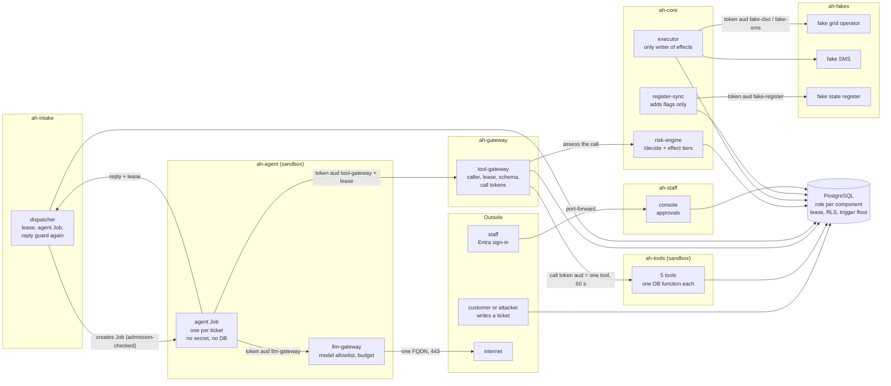
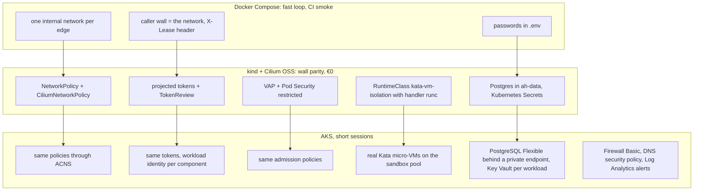

# Architecture

The agent is assumed hijacked. It never talks to a tool, the database or the internet directly; everything it can do goes through walls that hold even when the model obeys the attacker. This page is the map: the big picture, the trust zones, every network edge the walls allow, the decisions behind them, and how the local build differs from Azure. The attacks and the tests that stop them are in [attacks.md](attacks.md), the framework ids in [threat-mapping.md](threat-mapping.md), the Azure sessions and costs in [azure.md](azure.md).

Labels on design claims: ✓ checked in the linked source, ~ from memory or not re-checked, ✎ my own choice. Facts about this repository (file names, policy names, tests) are not labelled; the files are the source.

## Big picture

How the ticket reaches the database is outside this repository (there is no customer portal; the seed data and `attacks/` put tickets in). Every arrow above is an allowed edge in the table below; everything else is denied.

## Trust zones

| Zone | Namespace | Runs | Trusted with | Assumed |
|---|---|---|---|---|
| Agent | `ah-agent` | agent Job per ticket, Kata sandbox on Azure | the ticket text and the tool results of one lease | fully hijacked |
| Gateways | `ah-gateway`, `ah-agent` (llm-gateway) | tool-gateway, llm-gateway | caller identity, the lease, the signing key for call tokens, the model credential | honest, but exposed to the agent |
| Tools | `ah-tools` | five MCP servers, Kata sandbox on Azure | one database function each | could be malicious (a bad release or dependency) |
| Core | `ah-core`, `ah-intake` | dispatcher, risk-engine, executor, register-sync | effects, assessments, flags | honest; the database still checks the executor |
| Staff | `ah-staff` | console | approvals, as Entra object ids with an app role | honest code, people who make mistakes |
| Outside systems | `ah-fakes` | fake DSO, SMS, register | nothing | stand-ins; each takes calls from one caller only |
| Data | `ah-data` (kind) / private endpoint (Azure) | PostgreSQL | everything | the last wall |

## Communication matrix

Taken from the Helm chart (`deploy/helm/assume-hijacked/templates/_helpers.tpl`, helper `ah.edges`, and `templates/policies/`), not from an earlier design list. Every namespace starts with a `default-deny` NetworkPolicy for ingress and egress. Each edge then gets two NetworkPolicies, the egress half in the caller's namespace and the ingress half in the callee's, which select pods by `app.kubernetes.io/name` and the peer namespace by `kubernetes.io/metadata.name` (set by the API server, so a namespace cannot pose as another). What NetworkPolicy cannot express is in CiliumNetworkPolicies (DNS, the API server, names outside the cluster, the metadata endpoint). The edge numbers are the policy names.

| Edge | From → to | Port | Caller checked by | Enforced by |
|---|---|---|---|---|
| 03 | dispatcher → Kubernetes API | 443 (6443 on kind) | ServiceAccount token, RBAC: create Jobs in `ah-agent` only, and `ah-agent-job-template` admission | CNP `edge-03-dispatcher-to-kube-apiserver` |
| 04 | dispatcher → db | 5432 | role `dispatcher` | NP pair |
| 05 | agent → tool-gateway | 8080 | projected token, audience `tool-gateway`, TokenReview, pod name = the lease's `bound_pod`; lease in `X-Lease` | NP pair |
| 06 | agent → llm-gateway | 8083 | projected token, audience `llm-gateway` | NP pair |
| 07 | agent → dispatcher | 8081 | projected token, audience `dispatcher`, and the lease | NP pair |
| 08 | tool-gateway → risk-engine | 8082 | nothing but the network: only the gateway may connect ✎ | NP pair |
| 09 | tool-gateway → each tool | 8000 | call token: ES256, `aud` = that tool, 60 s, `jti` used once | NP pair, ingress names the gateway's namespace |
| 10 | tool-gateway, llm-gateway → Kubernetes API | 443 / 6443 | RBAC: create `tokenreviews` only | CNP `edge-10-*` |
| 11 | tool-gateway → db | 5432 | role `gateway`, `lease_scope()` only | NP pair |
| 12 | tools → db | 5432 | own role, EXECUTE on its one `api_*` function, no table grant | NP pair |
| 13 | risk-engine → db | 5432 | role `risk_engine` | NP pair |
| 14 | executor → db | 5432 | role `executor` | NP pair |
| 15 | executor → fake-dso, fake-sms | 8091, 8092 | projected token, audience `fake-dso` / `fake-sms`, TokenReview | NP pairs |
| 16 | register-sync → fake-register, db | 8090, 5432 | token audience `fake-register`; role `register_sync` | NP pairs |
| tokenreview | fake-register, fake-dso, fake-sms → Kubernetes API | 443 / 6443 | RBAC: create `tokenreviews` only | CNP `edge-tokenreview-*` |
| 18 | console → db | 5432 | role `approver`; staff sign in with Entra (`console.authMode=entra`) | NP pair |
| 19, 20 | llm-gateway → `api.anthropic.com`, or the Foundry endpoint + `login.microsoftonline.com`; console → `login.microsoftonline.com` (Entra mode); db-migrate → `login.microsoftonline.com` (Azure) | 443 | DNS rule for those names only, plus `toFQDNs` | CNP `edge-19-20-*` |
| db setup | postgres-init (kind) / db-migrate (Azure) → db | 5432 | bootstrap admin (kind) / Entra admin identity (Azure) | NP pair |
| 21 | `ah-monitoring` → port 9000 in every app namespace | 9000 | none: `/metrics` and `/healthz` carry names and counts only | NP ingress half |
| 22 | every pod → CoreDNS | 53 | Cilium's DNS proxy answers REFUSED for any name outside `cluster.local` (plus a pod's own names from rows 19, 20, and `db.host` on Azure) | CNP `edge-22-*` |
| metadata | every pod → 169.254.169.254 | any | denied in every namespace, whatever an allow says | CNP `deny-instance-metadata` (`egressDeny`) |

On Azure the database edges use an `ipBlock` with the private endpoint's range (`network.databaseCidr`, a private /24 or longer, checked by the chart) instead of a pod selector. Outside the chart: staff reach the console by `kubectl port-forward`; the owner reaches the AKS API from `api_authorized_ip_ranges` with Entra (local accounts off); GitLab CI reaches Azure Resource Manager with OIDC; node traffic (image pulls, Entra, Key Vault through the CSI driver) goes through the firewall when `enable_firewall` is on.

Locally with Docker Compose the same edges are one `internal: true` network per allowed pair (`compose.yaml`). `python -m secops.permassess` compares the edges and the database grants that are really there with `security/expected-permissions.json` and fails the pipeline on a difference ([permission-matrix.md](permission-matrix.md)).

The runtime proof is the probe matrix (`attacks/probes.py`, run by `tests/k8s/test_walls.py`): pods with each component's labels try every forbidden edge next to the allowed ones. A deny counts only with the wall's own signature (a TCP timeout, or REFUSED from the DNS proxy), so a probe that could not run never passes as a wall that held.

## Admission

Two layers, no Kyverno, no Gatekeeper (decision 9). Pod Security Admission `restricted` on every app namespace, and four ValidatingAdmissionPolicies (`templates/policies/admission.yaml`), each bound to namespaces by name:

| Policy | Refuses |
|---|---|
| `ah-images-pinned` | an image from another registry, or one without a digest |
| `ah-no-host-access` | privileged containers, privilege escalation, added capabilities, host namespaces, host ports, `hostPath` (repeats Pod Security, so removing the namespace label is not enough) |
| `ah-sandbox-runtime` | a pod in `ah-agent` or `ah-tools` without the sandbox RuntimeClass (the llm-gateway's own pods excepted) |
| `ah-agent-job-template` | any Job in `ah-agent` that is not exactly the agent Job template: only the name and the `ah/ticket` label may differ. The dispatcher may create Jobs, but not one that runs as another ServiceAccount, mounts a Secret, asks for another token audience, changes the image or command, or leaves the sandbox |

## Decisions

The numbered decisions are the ones the Terraform and chart comments refer to as "decision N". The unnumbered ones were fixed at the same time.

| # | Decision | Value |
|---|---|---|
| 1 | Region | North Europe (`northeurope`). Firewall Basic for a VNet is in its price list; in Sweden Central only the Virtual Hub variant is ✓ (Retail Prices API, queried 2026-10-18) |
| 2 | PostgreSQL networking | public access disabled, private endpoint |
| 3 | Workload database login | a password per role. Azure: one Key Vault per workload and the Secrets Store CSI driver (synced to a Kubernetes Secret, read as an environment variable); locally a Kubernetes Secret or `.env`. Humans and the db-migrate Job use Entra on Azure |
| 4 | Per-pod DNS rules | yes: CiliumNetworkPolicy `dns` rules (Cilium OSS on kind, Advanced Container Networking Services on AKS) and an Azure DNS security policy per VNet |
| 5 | Who judges each tool call | the risk engine's `/decide`, called by the gateway for every call, plus effect tiers assessed after the request is filed |
| 6 | Nodes on Azure | system pool 2 × Standard_D4als_v6 (tainted `CriticalAddonsOnly`); sandbox pool 1 × Standard_D4als_v6, Azure Linux, Kata (`kata-vm-isolation`), node count a variable (0 when nothing needs to run) |
| 7 | Real model | llm-gateway backends `scripted` (default, CI), `anthropic`, `foundry`; demo model `claude-haiku-5-5` |
| 8 | Approver identity | v1: the console validates the Entra ID token and records the object id and app role; the database enforces distinct approvers. v2 (backlog): staff log in to PostgreSQL themselves |
| 9 | Admission | ValidatingAdmissionPolicy and Pod Security Admission `restricted` |
| 10 | Subscription | pay-as-you-go, budgets €20 and €50 |
|   | Topology | hub and spoke, peered, no VPN gateway, no Bastion |
|   | Egress | Azure Firewall Basic, application rules only, behind the `enable_firewall` variable |
|   | Agent lifetime | one run per ticket (Compose: `docker compose run`; Kubernetes: one Job per ticket) |
|   | User interface | the approval console, a Grafana "Walls" board and the static evidence report; no customer chat (the attack replay is a CLI) |
|   | Threat frameworks | OWASP LLM 2025, OWASP Agentic 2026, MITRE ATT&CK, MITRE ATLAS, MITRE D3FEND (documentation only) |

## Local and Azure

The same chart, the same images (by digest) and the same SQL run in three places. What changes is the floor underneath.

| Wall | Compose | kind | Azure |
|---|---|---|---|
| Network edges | one internal network per pair | NetworkPolicy + Cilium | the same policies on ACNS, plus NSGs per subnet and the firewall |
| DNS exfiltration | internal networks have no route out | Cilium DNS rules | Cilium DNS rules and the DNS security policy on the VNet |
| Caller identity | the network and the lease | projected tokens, TokenReview | the same |
| Sandbox | none (containers) | the RuntimeClass exists, handler `runc`: no extra isolation | Kata micro-VM, own kernel per pod ✓ ([AKS Pod Sandboxing](https://learn.microsoft.com/en-us/azure/aks/use-pod-sandboxing)) |
| Secrets | `.env`, one password per container | Kubernetes Secrets | Key Vault per workload, CSI driver; db-migrate sets new passwords on every deploy |
| Staff identity | dev users | dev users or a real Entra tenant | Entra, app roles |
| Alerts | none (the console shows the alert list) | Prometheus and Alertmanager to a local mail catcher | Log Analytics alert rules to the owner's e-mail |

## The evidence report

`python -m secops.evidence` writes one static HTML page, `reports/evidence.html`, from the JSON reports of a run: the permission assessment (`reports/permissions/`), the probe matrix (`reports/k8s-probe-matrix.json`), the attack ticket replay (`reports/attack-replay.json`), the image references (`reports/image-digests.json`, written by `--collect-images`), and on Azure the saved Log Analytics query results (`reports/kql/*.json`, optional). The CI job `evidence` builds it from the pipeline's own reports.

It judges the data again instead of trusting a flag in it: a probe passes only with the wall's signature, an attack ticket only with `passed: true` and no failed check, a permission diff only with no extra or missing line, and its exit code must agree with its contents. A report that is missing is a "not run" section, and the page then says INCOMPLETE, never PASS. A file it cannot read is an error section. Every value is escaped, and the page loads and runs nothing (`Content-Security-Policy: default-src 'none'`). In CI the probe matrix and the attack replay are "not run": they need a cluster.

## Not protected yet

- ACR Basic has no dedicated data endpoints: they are a Premium feature, and without them layer downloads are redirected to `*.blob.core.windows.net` ✓ ([dedicated data endpoints](https://learn.microsoft.com/en-us/azure/container-registry/container-registry-dedicated-data-endpoints)). So AKS needs egress to that wildcard, which reaches every storage account in Azure, not only the registry's. A hijacked node-level process could write data to a storage account of its own through the firewall. Premium (€1.47 a day) or a private endpoint closes it.
- Calls to the grid operator and the SMS gateway are made at most once. The executor writes an `outside_call_due` event inside the transaction before the call and `outside_call_sent` or `outside_call_failed` after it, so a call lost to a crash shows as a due event with nothing after it. It is found from the events and sent again by hand; nothing retries it.
- A move-out held by the flood rule (tier HOLD) needs two distinct SeniorApprovers to release it, and the order still needs approvals given after the occupier notice. One person approves a request once, so in practice four distinct seniors are needed ~. That is slow on purpose, and a small team may not have four.
- Removing a protection flag needs two distinct SeniorApprovers who are not the requester; staff ids are Entra object ids (UUIDs), so one person has one spelling. Removal closes every other open removal request for that home. What the database cannot check (decision 8, v1) is that the person behind an approval holds the role the console wrote.
- Locally there is no e-mail for alerts outside the monitoring stack: in Compose the console's alert list is the only place an alert shows.
- The Kubernetes edges of an agent Job exist only while a Job runs. The permission assessment reads the cluster as it is, so with no ticket in flight the agent's edges are not assessed.
- The risk engine takes `/decide` from anything that can reach port 8082; only the network stops the rest (edge 08).
- On kind the sandbox RuntimeClass uses `runc`. The agent and the tools are ordinary containers there; only AKS gives them their own kernel.
