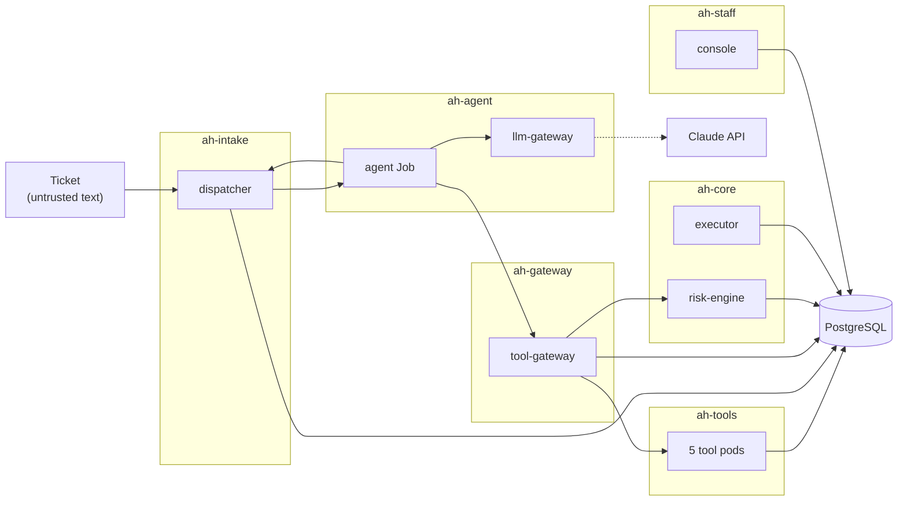

# Architecture

Nine parts, six trust-zone namespaces, one Helm chart. This page lists what each part may do, which network edges exist, and the move-out rules. [attacks.md](attacks.md) says which test proves each wall.

## Parts

| # | Part | One job |
|---|---|---|
| 1 | dispatcher | Picks the next ticket, opens a lease for that ticket's customer only, starts the agent Job, checks the reply again, stores it |
| 2 | agent | Asks the model what to do, drops arguments the model may not set, adds the lease, calls tools only through the tool-gateway. Holds no DB password and no model key |
| 3 | llm-gateway | The only holder of the Claude key; token budget per lease |
| 4 | tool-gateway | Checks caller, lease, tool list, arguments and the tool description fingerprint; asks the risk engine; signs a short token per call; writes the call record |
| 5 | risk-engine | Scores each call and each requested effect; answers allow, deny or wait for a human; pauses all agents after three denials on one lease (kill switch) |
| 6 | tools | Five pods from one image and one Helm template (`serve.py <tool>`). Each pod is one tool, logs in as its own DB role, runs only its own DB function and cannot reach the other tools |
| 7 | executor | The only part that writes effects (credits, move-out orders), after the approvals its risk tier needs |
| 8 | console | Staff sign in, see what waits, approve; resume the agents after the kill switch |
| 9 | PostgreSQL | Data. One role per service and per tool, row-level security, append-only audit, triggers as the last wall |

The tools are five processes on purpose. A hijacked tool then holds one database role and one function, and the per-call token names the tool it is for.

The five: `read_ticket` returns the text of the lease's ticket. `lookup_account` returns the lease's customer only. `issue_bill_credit` files a credit request. `request_disconnection` files a move-out request. `set_temp_protection` marks a home protected and only adds.

## Namespaces and edges

`ah-intake`, `ah-agent`, `ah-gateway`, `ah-tools`, `ah-core` and `ah-staff` hold the parts as drawn. On kind, PostgreSQL runs in `ah-data`; on Azure it is a managed server behind a private endpoint, and the chart allows port 5432 to that subnet only. The monitoring stack lives in `ah-monitoring` and is not part of the chart.

Every namespace is default-deny (Cilium). The chart renders one allow rule per edge and nothing else:

| Edge | Port |
|---|---|
| agent to dispatcher | 8081 |
| agent to llm-gateway | 8083 |
| agent to tool-gateway | 8080 |
| tool-gateway to risk-engine | 8082 |
| tool-gateway to the five tools | 8000 |
| dispatcher, tool-gateway, the five tools, risk-engine, executor, console and the database setup job to PostgreSQL | 5432 |
| Prometheus (`ah-monitoring`) to every namespace | 9000, metrics only |

Only the llm-gateway may reach a name outside the cluster (the model API). The console reaches Entra, and on Azure the `db-migrate` job reaches Entra and Key Vault. Nobody reaches 169.254.169.254, and DNS names outside the cluster are refused. `test_network_edges_are_exactly_the_matrix` compares the rendered policies with the chart's edge list.

Admission policies (`ValidatingAdmissionPolicy`): images only by digest from the allowed registry, no privileged or host-access pods, the sandbox RuntimeClass for the agent and the tools, and an agent Job only from the dispatcher's fixed template. The chart never starts an agent; the dispatcher may create Jobs only in `ah-agent`.

## Identities

- **Workloads.** One ServiceAccount per part. Callers prove who they are with projected tokens, one audience per peer, checked with TokenReview. The agent has no database credentials and no key.
- **Per call.** The tool-gateway signs an ES256 token for each tool call (audience is that tool, short expiry, replay refused). The signing key is on the tool-gateway only.
- **Database.** One login role per part and per tool. Passwords come from Kubernetes Secrets on kind and from Key Vault on Azure. A tool role has no table grants, only `EXECUTE` on one function.
- **Model key.** Only the llm-gateway.
- **Staff.** On Azure the console signs staff in with Entra ID (authorization code flow with PKCE; app roles `Approver` and `SeniorApprover`; the approver is recorded by the token's `oid`). On kind, `AUTH_MODE=dev` lists identities in the chart values and the console accepts the `X-Dev-User` header; it refuses to start in dev mode on Azure. A real Entra sign-in has not been run.
- **Azure.** Terraform builds one user-assigned identity and one Key Vault per part from `permissions/`. Nothing is applied yet.

## Permissions

One JSON file per part in `permissions/` declares its database role and grants, network peers, ServiceAccount and RBAC, Azure identity and RuntimeClass. Terraform, the Helm chart and the gateway read the same files, and `test_db_grants_match_the_manifest_of_each_login_role` compares the real grants in the database with them. The table is read from those files; grants are shortened to the verbs and sequence grants are left out.

| Part | Namespace | DB role | What the role may touch in the database | Receives from | Calls |
|---|---|---|---|---|---|
| dispatcher | ah-intake | `dispatcher` | tables: agent_runs (select/insert/update), replies (select/insert), tickets (select); runs: beat, finish_reply_facts, lease_scope, open_lease, reply_facts, revoke_lease | agent | db |
| agent | ah-agent | `none` | nothing | - | dispatcher, llm-gateway, tool-gateway |
| llm-gateway | ah-agent | `none` | nothing | agent | - |
| tool-gateway | ah-gateway | `gateway` | tables: agent_control (select), tool_calls (insert); runs: beat, lease_scope | agent | db, risk-engine, tool-read-ticket, tool-lookup-account, tool-request-disconnection, tool-issue-bill-credit, tool-set-temp-protection |
| risk-engine | ah-core | `risk_engine` | tables: action_requests (select), agent_control (select), call_assessments (select/insert), charges (select), risk_assessments (select/insert), tool_calls (select); runs: beat, blocked_calls_on_ticket, home_protection, pause_agents, required_approvals, risk_lease_facts | tool-gateway | db |
| tool-read-ticket | ah-tools | `tool_read_ticket` | runs: api_read_ticket | tool-gateway | db |
| tool-lookup-account | ah-tools | `tool_lookup_account` | runs: api_lookup_account | tool-gateway | db |
| tool-issue-bill-credit | ah-tools | `tool_issue_bill_credit` | runs: api_request_credit | tool-gateway | db |
| tool-request-disconnection | ah-tools | `tool_request_disconnection` | runs: api_request_moveout | tool-gateway | db |
| tool-set-temp-protection | ah-tools | `tool_set_temp_protection` | runs: api_set_temp_protection | tool-gateway | db |
| executor | ah-core | `executor` | tables: accounts (select), action_requests (select/update), approvals (select), charges (select), credits (select/insert), disconnection_orders (select/insert), events (select/insert), flags (select), risk_assessments (select), supply_points (select); runs: beat, check_approval_floor, required_approvals, advisory locks | - | db |
| console | ah-staff | `approver` | tables: action_requests (select/update), approvals (insert), events (insert/select), risk_assessments (select), heartbeats (select), agent_control (select); runs: required_approvals, resume_agents | staff browser | db, Entra |
| db-migrate | ah-core (azure only) | `none` | nothing | - | db, Entra, Key Vault |
| db | ah-data (kind only) | `none` | nothing | - | internet |

The agent and the five tools run with the `kata-vm-isolation` RuntimeClass, everything else with `runc`. Every part with an Azure identity gets `Key Vault Secrets User` on its own vault. `db-migrate` gets `Key Vault Secrets Officer` on all vaults, because it writes the generated passwords. The `db` row is the database itself: the function owners (no login), what `PUBLIC` holds, and row-level security.

## Risk tiers

Pure functions in `app/risk/rules.py`, one table-driven test per rule.

- **Calls.** Checked in order, first hit wins: agents paused, lease not live, tool not in the lease, third denial on the lease (pauses all agents), 8 calls per lease, a second effect call.
- **Credits.** A hard rule rejects a missing or non-positive amount. Otherwise points add up: above the automatic limit, above 200 EUR, reason is not a duplicate charge, evidence not confirmed, two refused credits in the last hour, earlier blocked calls. Score 0 is T0, 1 to 69 is T1, 70 and more is T2.
- **Approvals.** T0 needs none, T1 one, T2 two, from distinct people, given after the assessment was written. The executor re-checks evidence and limits, and a database trigger checks the approval floor again.

## Move-out rules

1. A home is protected if it has a flag row, otherwise not. There is no register and no freshness check.
2. Protected home: tier HUMAN_ONLY, and no order is ever written, whatever the approvals.
3. Not protected: T1 or T2 from the score. T1 needs one approval, T2 two from distinct people. Every order needs at least one approval, so there is no automatic move-out.
4. The trigger on the order table checks 2 and 3 on its own, without trusting the risk engine or the executor.
5. Flags are add-only. The database refuses every protection downgrade, from any role, the superuser included. A flag is removed only by a database admin by hand, outside the app.

The `SeniorApprover` role stays for one job: resuming the agents after the kill switch.

## Console

The queue shows request ids, risk tiers, rule codes and component heartbeats. It never renders ticket bodies, customer details or event detail. Requests that are HUMAN_ONLY, or still waiting for an assessment, show a protected-customer warning and cannot be approved; a rejection records `staff_rejected`. Every write needs the session cookie and a CSRF token, and identity or role fields in a submitted action never override the session. Sessions are in memory, so run one replica. The Secure cookie does not survive plain HTTP port-forwarding outside `APP_ENV=local`; how staff sign in on AKS is still open (see [azure.md](azure.md)).

## What v2 removed from v1

Docker Compose and the fake outside world (register, SMS, DSO, notices) are gone, and so are the 72-hour notice, the two-senior flag removal, the move-out flood rule and the Foundry backend. Three Terraform stacks became two (`infra/net` was merged into `lab`), 18 CI jobs became three, and five threat frameworks became one (OWASP ASI). v1 is the git tag `v1`.
