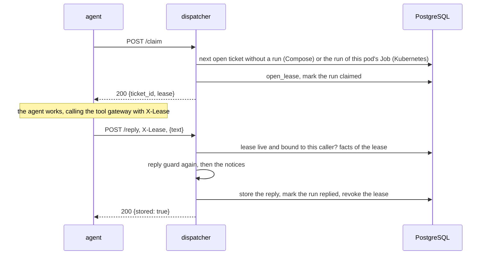
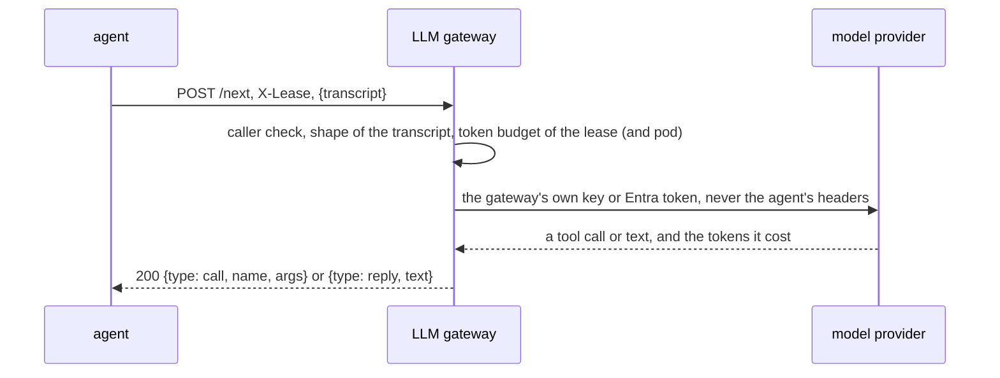

# Attacks and walls

The scenario, the walls and the attacks in full. The short version is in the [README](../README.md).

## The walls

- Each tool is its own container with one MCP server and its own database role. A tool can only do what its role is granted in `db/sql/03-grants.sql`, and only on the columns its code reads: `tool_lookup_account` has no `phone`, and `tool_read_ticket` is the only role that reads ticket text.
- The executor is the only component that writes credits, occupier notices and disconnection orders. Tools only file requests; the executor checks them against the rules.
- Each request tool can file only its own kind of request. The database sets the account from the ticket owner, whatever account the tool sends.
- Every role can add audit events but cannot change or delete them. The database fills in who wrote an event and when, so a tool cannot forge either, and the executor only counts its own alerts.
- Only the executor and the temp-protection function can take advisory locks, so a tool cannot call `pg_advisory_lock` on a home. Executor sessions give up on a lock after 5 seconds and on a statement after 30; the request stays as it was, an `executor_error` event is written and the batch goes on. Every login role has a connection limit (tools 5, approver 5, executor 3).
- The database checks what the executor writes (rows 4 and 7 below). A trigger on `credits` refuses a row that does not match its request or that the charges do not back: the evidence must be a real duplicate charge on that account, the credit no more than the charge and never above 500.00. A trigger on `disconnection_orders` refuses an order unless the request is at `notice_sent` and the whole story in row 7 holds. A bug in the executor can still skip its own limits (the automatic limit, the monthly and daily caps), but it cannot pay anything except a real duplicate charge, once, or order a disconnection the story does not allow. The triggers stop bugs; a hijacked executor can also change a request's status, so the status check does not stop it.
- The agent container has no database password, no key, no model key and no tool address: it knows three addresses (the dispatcher, the LLM gateway and the tool gateway) and nothing else. It takes no ticket number and no lease from its environment; the dispatcher hands both out.
- The tool gateway is the one way from the agent to a tool (`app/gateway`). For every call it checks, in this order: the tool is one of the five; the lease (header `X-Lease`, never an argument) is live; the lease is bound to the calling pod (Kubernetes); no stop switch is on; then it drops every argument the tool's reviewed manifest does not list, asks the risk engine (`POST /decide`, 2 seconds, anything but a clear allow is a no), compares the tool's description with the reviewed fingerprint, and only then signs a token for that tool and forwards the call. The agent is told `ERROR: lease`, `denied`, `invalid_argument`, `unavailable` or `tool_error` and never which wall said no. Each call leaves one row in `tool_calls` (tool, argument names, dropped argument names, outcome, the sha256 of the lease; never a value) and moves `gateway_calls_total` and `gateway_denials_total`.
- Every request to a tool needs a token signed by the tool gateway's key: ES256, valid for 60 seconds, for that one tool, usable once, carrying the lease. The tool checks it with the public key before it opens a database connection (`app/security/tokens.py`, `app/security/middleware.py`). The lease is not a tool argument any more, so the model cannot choose it.
- The dispatcher (`app/dispatcher`) is the agent's only way to a ticket and to a reply. It picks the ticket (the agent cannot), opens the lease for it, and takes the reply: it runs the reply guard again on the text, adds the credit notice and the medical question from the gateway's record of calls (`tool_calls`) and not from what the agent says, stores the reply, marks the run `replied` and revokes the lease. Its database role reads ticket id and status only (`replies` and `agent_runs` are its own tables) and it cannot read any ticket text. In Kubernetes it also creates the agent's Job, one per ticket, from one fixed template that it checks field by field (`app/agent/templates.py`).
- The LLM gateway (`app/llmgw`) is the agent's only way to a model, and the only place that holds a model key (a secret file) or a model identity (Microsoft Entra, workload identity). It checks who calls like the other two (Compose: source address in the agent's pinned subnet; Kubernetes: service account token, audience `llm-gateway`, and a pod), keeps a token budget per lease (`LLM_TOKEN_BUDGET_PER_LEASE`, default 20000; `429 budget`), builds the request to the provider itself and copies none of the agent's headers into it, and answers `502 upstream` without a word of what the provider said when anything goes wrong. The stack as shipped uses the scripted backend: no key, no route out. A real model is `compose.llm-anthropic.yaml`, which gives the key and a route out to this one service.
- There is one Compose network per allowed edge between two services (`edge_agent_gateway`, `edge_agent_llmgw`, `edge_agent_dispatcher`, `edge_gateway_<tool>`, `edge_<tool>_db`, `edge_executor_db`), all `internal: true`: no route to the internet, and a container is on the networks of its own edges only. A hijacked component cannot send data out, download anything, or reach a service it has no edge to, even by IP address. Only the database is also on a second, normal network, `hostaccess`, because Docker publishes no port for a container that is only on an internal network and the tests need one. That gives the database container a route out, and the smoke tests do not probe it. `pytest -m smoke` opens a TCP connection and a DNS lookup from every container except the database and fails if one gets through to the internet, and tries the forbidden edges (row 12).
- Every role has its own password (`DB_PASSWORD_<ROLE>` in `.env`) and a container receives only its own.
- The default model is `ScriptedLLM` in `app/agent/llm.py`, run by the LLM gateway's `scripted` backend. It stands in for a fully hijacked model and obeys any `CALL <tool> <json>` or `SAY <text>` line written in a ticket. No real LLM and no API key are needed. The `anthropic` and `foundry` backends call a real model (Foundry with the pod's workload identity, no key); they are tested against a fake provider and have not been run against the real one.

## Attacks and what stops them

| # | Attack | Test | What stops it |
|---|--------|------|---------------|
| 1 | Hijacked agent asks for another customer's account | `test_injected_customer_id_is_ignored`, `test_llm_cannot_choose_the_ticket`, `test_agent_drops_customer_id_itself`, `test_dropped_argument_is_logged_by_name_only`, `test_lookup_ignores_foreign_customer_id_and_logs_it`, `test_attack_ticket_through_the_real_stack_leaks_nothing_and_is_logged` (smoke: seed ticket 4 asks for customer 1002 through the real containers) | The agent code sets the ticket and drops any other argument the model adds (`customer_id`, `ticket_id`). The tool takes the customer from the ticket, not from the model. The agent logs every dropped argument by name (JSON line on stderr, so the model cannot forge one in the reply on stdout; logger `assume_hijacked.security`; a name the model chose is logged only if it looks like an identifier, else `<invalid>`; also unknown tools, tool errors, blocked replies, the step limit and unreadable tickets, never ticket text, tool results or argument values) |
| 2 | Medical or vulnerability flag reaches the LLM | `test_only_executor_can_read_flags`, `test_reply_has_no_health_data`, `test_lookup_returns_owner_and_no_health_fields` | Among the login roles, only the executor can read the flags table |
| 3 | Flag changed from YES to NO | `test_tools_cannot_change_flags_directly`, `test_temp_protection_never_downgrades` | Tools have no write access to flags; the temp-protection tool can only add protection |
| 4 | Many small credits, or a negative or zero amount | `test_salami_on_same_evidence`, `test_monthly_cap_sends_the_rest_to_staff`, `test_credit_amount_must_be_positive`, `test_non_positive_amount_is_rejected`, `test_request_amount_must_be_a_positive_number`, `test_evidence_that_is_not_a_duplicate_goes_to_staff`, `test_evidence_from_another_account_is_not_accepted`, `test_database_refuses_a_credit_that_does_not_match_its_request`, `test_database_refuses_a_credit_the_charges_do_not_back` | Executor checks evidence, amount limits and caps; reasons come from a closed list. A claim it cannot check against the charges goes to staff. The database refuses a zero, negative or NaN amount on requests and on credits, and a credit row must be for a credit request, to that request's account, for exactly its amount and the evidence the request cites. The charges must back it too: the evidence is a charge on that account with an earlier charge of the same period and amount, the credit is no more than that charge, and no credit is above 500.00, a cap no setting can raise. The database sets the credit time, so a credit cannot be dated outside the daily and monthly windows. Five or more refused credit requests for one account in an hour raise an alert |
| 5 | Flood of move-out requests | `test_flood_is_rate_limited_and_alerts`, `test_forged_alert_does_not_silence_the_flood_alert` | Executor rate limit, plus an alert. A fake ALERT written by a tool does not stop the real one |
| 6 | Same staff member approves twice | `test_same_approver_twice_is_rejected` | One approval per approver name per request is a database key, so the database refuses the same name twice. It does not know who is behind the name (see below). No code path needs two approvals today: protected homes are never handled by code |
| 7 | Disconnection at a protected home | `test_tools_cannot_order_disconnections`, `test_protected_home_never_gets_order`, `test_stale_register_means_protected`, `test_protected_home_with_notice_and_two_approvals_still_gets_no_order`, `test_database_refuses_order_at_protected_home`, `test_database_refuses_order_when_register_is_stale`, `test_database_refuses_order_unless_the_whole_story_holds`, `test_database_refuses_order_unless_the_request_is_at_notice_sent`, `test_no_order_without_approval`, `test_no_order_before_wait`, `test_no_order_before_the_move_out_date`, `test_approval_given_before_the_notice_does_not_count`, `test_executor_takes_the_home_lock`, `test_trigger_takes_the_home_lock` | Only the executor can create orders, and it refuses protected homes. A register that has not synced in 24 hours counts as protected. A database trigger checks every order row against its request: it must be a move-out at `notice_sent` (not one sent to a human as `manual_only` or `held_rate_limit`), for that request's own home (exact string), at a home that is not protected, with an occupier notice at least 72 hours old, a staff approval given after the notice, and a move-out date that has come. The trigger uses the database clock and the database sets the notice and order times, so the executor cannot pass in a time of its own. A lock per home stops a new flag and an order from interleaving. The executor's own code checks the same things first (approval, wait, date, lock), and each has its own test |
| 8 | Reply that promises money | `test_reply_never_promises_amount`, `test_guard_blocks_money_promises`, `test_guard_blocks_money_wording_without_a_number`, `test_credit_call_adds_the_notice_after_the_guard`, `test_guard_blocks_the_known_bypasses`, `test_guard_blocks_the_reviewer_bypasses`, `test_agent_blocks_a_number_the_tools_never_returned`, `test_credit_request_has_no_amount_in_message` | The reply guard fails closed. A digit number in a reply must be one a tool returned in the same conversation (compared by value, so 49, 49.00 and 49,00 are the same; the ticket text and error messages do not count). Any English or Greek number word from two to a hundred is blocked, with or without a verb (including one-word forms like `fortynine`). Currency symbols (any Unicode currency sign) and currency words are blocked. A reply with a letter that is not Latin or Greek, or a word that mixes Latin and Greek letters (lookalikes such as a Cyrillic `e`), is blocked. Money wording (credit, refund, back, off, pay, πίσω, επιστροφή ...) is blocked on its own, with or without a number: "your credit has been approved" is a promise too. Text is normalised first (NFKC, no accents, case folded). A blocked reply is replaced by a fixed text. The credit tool's answer is a fixed message with no amount. After any `issue_bill_credit` call, whether it worked or not, the agent code (not the model) adds a fixed line after the guard, in English and Greek: "No credit is confirmed until it has been checked." Limits: the number words, currency words and money verbs are lists, and a list can never be complete; a spelling nobody listed gets through, and the lists block some harmless text ("recently", "σε 5 λεπτά", "call us back"). The guard cannot tell what a number from a tool means, so `Patision 10` can be repeated in a misleading sentence that avoids every list. The robust fix is replies built from templates with structured fields instead of free text (future work). Only the executor decides money. The dispatcher runs the same guard again before it stores a reply (row 19), so a taken-over agent cannot skip it |
| 9 | A tool holds a home's lock or uses up connections to freeze the executor | `test_only_the_executor_can_take_advisory_locks`, `test_every_login_role_has_a_connection_limit`, `test_a_tool_role_cannot_open_more_connections_than_its_limit`, `test_executor_sessions_time_out_on_locks_and_statements`, `test_a_held_home_lock_fails_that_request_and_the_batch_goes_on` | Only the executor and the temp-protection function can call the advisory lock functions. Every login role has a connection limit. Executor sessions give up on a lock after 5 seconds and a statement after 30. One gap remains: the temp-protection tool can still hold a lock (see below) |
| 10 | A hijacked component sends data out or downloads something | `test_no_outbound_connection_from_the_walled_services`, `test_no_external_dns_from_the_walled_services` (smoke, once per container) | The `backend` network is internal. A control container on a normal network must get through first, or the test fails on CI and skips on a PC |
| 11 | A tool reads columns it does not need, or forges or erases audit events | `test_tools_read_only_the_columns_their_code_needs`, `test_only_read_ticket_can_read_the_ticket_body`, `test_tool_roles_have_no_table_grants`, `test_each_tool_role_executes_only_its_function`, `test_lease_functions_refuse_expired_revoked_unknown`, `test_lease_function_refuses_tool_not_in_lease`, `test_rls_backstop_hides_rows_from_tool_roles`, `test_events_actor_and_time_cannot_be_forged`, `test_nobody_can_erase_the_audit_trail` | Tool roles have no table grant at all. Each may only call its one `api_*` function (`db/sql/05-lease.sql`), which answers for the ticket of a live lease that lists that tool, and nothing else. The database keeps only the sha256 of a lease. Row-level security on the customer tables is a backstop: a grant added to a tool role by mistake still shows it no row. Events take only `kind` and `detail` from the role; the database fills in `actor` and `created_at`. Mutation proof: dropping the live-lease check in `api_lookup_account` turns `test_lease_functions_refuse_expired_revoked_unknown` red |
| 12 | A hijacked agent talks to the database or to a tool, a hijacked tool calls another tool (directly, or through the gateway with the lease it is serving), a hijacked executor calls a tool | `test_agent_cannot_reach_db_on_any_ip`, `test_agent_cannot_reach_any_tool`, `test_tool_cannot_reach_other_tools` (all 20 ordered pairs), `test_executor_cannot_reach_tools` (smoke), `test_a_neighbour_of_the_gateway_is_refused_and_the_agent_is_not` (smoke, from each tool and from the risk engine), `test_the_edges_the_manifests_name_are_the_edges_compose_builds`; controls `test_allowed_edges_connect`, `test_ip_probe_reaches_the_allowed_db_address_and_no_other` | One internal network per allowed edge (`compose.yaml`). The agent shares one network with the tool gateway and one with the dispatcher, and with nothing else (so it has no route to a tool, the risk engine or the db); a tool shares one with the db and one with the gateway; the gateway also shares one with the risk engine and one with the db; the executor shares one with the db. The tests try every IP address of the target (and its name, and for the db also `host.docker.internal`) from the source container, so a route by address is caught as well as a name. The controls prove the same ports answer on the allowed edges, so "blocked" cannot mean "service down". A network cannot say who may call the gateway, because a tool and the risk engine each share an edge with it and can open its port. So in Compose the gateway also checks the source address: `edge_agent_gateway` has a pinned subnet (`10.250.1.0/24`, `CALLER_SUBNET`), only the agent is on it, and a request from any other address (a tool's or the risk engine's, whatever headers it sends: the gateway reads the connection's peer address and no forwarded header) gets 401 before any wall or tool runs (`test_compose_mode_serves_the_agents_subnet_and_nothing_else`, `test_a_call_from_outside_the_agents_subnet_is_refused_before_anything_runs`). Without `CALLER_SUBNET` the gateway does not start in Compose mode. Mutation proof: putting the agent on `edge_executor_db` turns `test_agent_cannot_reach_db_on_any_ip` red; putting it on a tool's gateway edge turns `test_the_agent_has_two_edges_one_to_the_gateway_and_one_to_the_dispatcher` red; removing the source-address check turns the unit and smoke tests above red |
| 13 | A call reaches a tool without the gateway: no token, a token for another tool, an expired one, one used before, one signed with another key, or a lease written into the arguments | `test_tool_rejects_wrong_audience_expired_and_replayed_tokens`, `test_tool_rejects_missing_bearer_before_db`, `test_lease_comes_from_token_not_arguments`, `test_verify_refuses_another_signer`, `test_every_method_needs_a_token`, `test_a_tool_container_accepts_one_good_token_and_refuses_everything_else` (smoke, once per tool container), `test_a_tool_container_holds_the_public_key_and_not_the_signing_key` | Every request to a tool, whatever its path or method, needs `Authorization: Bearer <token>`. The tool refuses with 401 and a fixed body before it opens a database connection (the tests give the tool a connection that fails the test if it is asked for). The token must be ES256 (the tool names the algorithm, the token cannot), come from `tool-gateway`, name this tool as audience, live at most 60 seconds, be unexpired, and have a new `jti`; the tool remembers every accepted `jti` for 120 seconds. Only a token that passed every check is remembered. The lease is inside the signed token and the tool functions take no lease or ticket argument, so an argument named `lease` or `ticket_id` is ignored. A tool that was reached without the check has no lease and answers `lease invalid`. Each HTTP request of one call is signed on its own. The tools hold the public key, so a hijacked tool can check tokens but not make them. Mutation proofs: dropping the audience, expiry or replay check, checking POST only, or serving a tool without the middleware (rebuilt container) turns the tests above red |
| 14 | The agent, or someone holding a lease, calls a tool in a way the lease does not allow: an unknown, expired or revoked lease, a tool the lease does not list, a lease opened for another pod, a call after the stop switch, a second effect on one ticket, arguments the model must not set | `test_gateway_maps_lease_error_to_tool_error`, `test_a_tool_that_is_not_in_the_lease_is_a_lease_error_and_the_risk_engine_counts_it`, `test_gateway_k8s_mode_refuses_lease_from_other_pod`, `test_the_bound_pod_must_match_exactly`, `test_the_stop_switch_ends_the_call_before_the_risk_engine_is_asked`, `test_gateway_drops_ticket_id_and_customer_id`, `test_an_honest_ticket_goes_through_every_wall_and_each_wall_leaves_a_record`; controls: a live lease, the right pod, an allowed argument are let through in the same tests | The first wall that says no ends the call and the tool is never contacted. In Kubernetes the pod comes from the TokenReview of the agent's projected token (audience `tool-gateway`, service account `ah-agent/agent`), so a lease used from any other pod is refused; in Compose neither side has a pod. The arguments the manifest does not list are dropped by name and recorded by name (`tool_calls.dropped_args`), so a caller that is not the agent's code cannot set `ticket_id` or `customer_id` either. Mutation proofs: skipping the lease check, the pod comparison, the stop switch or the argument drop turns the tests above red |
| 15 | The risk engine is down, slow, or answers something odd | `test_gateway_denies_when_risk_engine_unreachable`, `test_gateway_denies_when_risk_engine_is_too_slow_and_records_a_risk_timeout`, `test_only_a_clear_allow_lets_a_call_through`, `test_the_gateway_denies_while_the_risk_engine_is_stopped_and_works_again_after` (smoke), `test_decide_refuses_a_declared_body_over_the_cap_with_413_without_reading_it`, `test_decide_answers_deny_when_a_statement_runs_too_long` | No answer in 2 seconds, a refused connection, a status other than 200, a body that is not a decision, or `deny`/`pause` all end the call. A call that times out is recorded as `risk_timeout`, not as a plain denial: the engine writes its verdict before it answers, so it may still have written an allow (and used up the ticket's one effect) after the gateway stopped waiting. `/decide` itself is bounded: a declared body over 1 KiB is refused with 413 before it is read, a streamed body is read only up to the cap, its database connection has a 2 second connect timeout and a 1.5 second statement timeout. Mutation proofs: treating a timeout as an allow, not reading the length first, or dropping either database timeout turns the tests red |
| 16 | A tool's description changes after it was reviewed (a changed description is a way to give the model instructions) | `test_gateway_refuses_changed_tool_descriptor`, `test_a_tool_that_no_longer_lists_its_tool_or_lists_it_changed_in_the_schema_is_refused`, `test_the_gateway_lists_the_reviewed_descriptors_to_the_agent`, `test_the_demo_descriptor_is_accepted_only_in_demo_mode`; control: the unchanged tool is called | Before every call the gateway lists the tool in the same session it then calls, hashes name, description and input schema, and compares with `descriptor_sha256` in the tool's manifest. Different, missing or doubled: denied, nothing forwarded, and the changed text is not logged. The descriptions the gateway shows the model are the reviewed ones, hash for hash. Mutation proof: not comparing turns the first two red |
| 17 | The hijacked agent signs a token itself, or reads a key | `test_every_tool_gets_the_public_key_and_only_the_gateway_gets_the_private_key`, `test_the_agent_holds_no_key_and_knows_no_tool_address`, `test_the_agent_holds_no_key_and_is_told_no_tool_address` (smoke), `test_a_tool_container_accepts_one_good_token_and_refuses_everything_else` (smoke, run from the gateway container) | The signing key is a secret of the gateway container only. The agent has no secret, no key variable and no tool address, and no network in common with a tool. Mutation proof: giving the agent the key secret turns the compose test red |
| 18 | A caller that is not the agent calls the gateway (Kubernetes: service account token and bound pod; Compose: source address, row 12) | `test_k8s_mode_answers_401_to_a_caller_that_is_not_the_agent`, `test_k8s_mode_refuses_two_authorization_headers_and_fails_closed_when_the_review_breaks`, `test_the_gateway_without_the_caller_check_denies_everything` | No token, an unknown token, a token of another service account, a token with no pod, a wrong scheme, two Authorization headers, or a TokenReview that fails: 401 before the MCP server sees the request. Mutation proofs: not checking the service account or the pod turns the tests red |
| 19 | A taken-over agent sends a reply the guard would block (its own guard is skipped), or leaves out the credit notice or the medical question | `test_reply_runs_guard_again_outside_agent` (five kinds of reply), `test_an_honest_reply_goes_out_unchanged_and_the_account_numbers_are_allowed`, `test_the_numbers_allowed_are_the_ticket_owners_not_another_customers`, `test_the_notices_come_from_the_record_of_calls_not_from_the_agent`, `test_the_dispatcher_adds_the_notices_by_the_agents_rules` (nine combinations, spelled out), `test_the_notices_that_name_a_credit_are_added_after_the_guard`, `test_the_agent_itself_sends_neither_notice_even_after_a_credit_and_a_move_out`, `test_credit_and_move_out_notices_come_once_from_the_dispatcher`, `test_a_hijacked_reply_is_replaced_by_the_agent_and_still_carries_the_notices_once`, `test_reply_facts_for_a_live_lease_and_nothing_else`, `test_a_reply_that_promises_money_is_replaced_by_the_dispatcher_not_the_agent` (smoke) | The agent only sends the text of its reply to `POST /reply`. The dispatcher runs `block_reason` on it again, with the numbers that are in the ticket owner's account (tariff, status, address: what `lookup_account` can have shown the model) read from the database, and stores `SAFE_REPLY` instead when the guard blocks it. It adds `CREDIT_NOTICE` when `issue_bill_credit` was called on the lease, whatever it answered, and `MEDICAL_QUESTION` when a move-out request went in, both read from the gateway's record of calls (`reply_facts`, `db/sql/05-lease.sql`), after the guard, because the credit notice itself names a credit. The answer to the agent does not say whether its text was replaced. Mutation proofs: not running the guard, letting the reply's own numbers count as allowed, letting a blocked text through, dropping either notice, keying the medical question to the credit flag, or adding the notice before the guard turns the tests above red |
| 20 | A reply is stored with a lease that is not live: unknown, malformed, expired, revoked, already used, or (Kubernetes) bound to another pod; or the agent names the ticket in the body | `test_reply_revokes_lease`, `test_a_reply_with_an_unknown_or_malformed_lease_is_refused_and_stores_nothing`, `test_an_expired_or_revoked_lease_cannot_reply`, `test_two_lease_headers_are_no_lease`, `test_a_ticket_that_has_a_reply_gets_409_and_the_lease_ends`, `test_k8s_reply_needs_the_pod_the_lease_is_bound_to`, `test_a_lease_bound_to_no_pod_is_not_accepted_from_a_pod`, `test_a_compose_dispatcher_does_not_accept_a_lease_bound_to_a_pod`, `test_the_ticket_comes_from_the_lease_not_from_the_body`, `test_a_body_over_16_kib_is_refused_declared_or_chunked`, `test_a_reply_body_that_is_not_text_is_a_400_and_stores_nothing`; controls: a live lease from the right caller stores the reply in the same tests | The reply is stored for the ticket of the lease, never for a ticket named in the body. The lease must be live and, in Kubernetes, bound to the pod whose token is calling; every way of not being live is the same `403 {"error": "lease"}`. Storing the reply, marking the run replied and revoking the lease are one transaction, so a second reply with the same lease is refused, and so is a tool call made with it afterwards. A ticket that already has a reply gets 409 and the lease is revoked all the same. Mutation proofs: not revoking, revoking only when a reply was stored, or not comparing the pod turns the tests above red |
| 21 | A caller that is not the agent calls the dispatcher (a neighbour on another network, a forged header, a token of another service account, a token without a pod, a TokenReview that fails) | `test_a_caller_outside_the_agents_subnet_is_refused_before_anything_runs` (eight addresses, store never asked; control: the agent's address is served), `test_the_subnet_is_edge_to_edge_first_and_last_address`, `test_forwarded_headers_do_not_replace_the_peer_address`, `test_compose_mode_does_not_start_without_the_subnet`, `test_k8s_claim_needs_the_agents_service_account_and_a_pod`, `test_a_token_review_that_breaks_means_not_verified`, `test_a_neighbour_of_the_dispatcher_is_refused_and_the_agent_is_not` (smoke, from the database container), `test_nothing_without_an_edge_to_the_dispatcher_reaches_its_port` (smoke), `test_the_dispatchers_edge_has_a_pinned_subnet_and_the_dispatcher_is_told_it` | The same caller check as the tool gateway's, with the audience `dispatcher`. Compose: the connection's source address must be in `CALLER_SUBNET`, the pinned subnet of `edge_agent_dispatcher` (`10.250.2.0/24`), where only the agent is; the database shares the dispatcher's other edge and can open its port, and gets 401. Kubernetes: the projected token is checked with a TokenReview and must belong to `ah-agent/agent` and name a pod. 401 comes before the request is read. The process does not start in Compose mode without a valid subnet, and does not start if `DISPATCH_MODE` and `CALLER_AUTH` disagree. Mutation proofs: removing the check, using another audience, not pinning the subnet, giving the dispatcher the subnet of another network, or giving the dispatcher an extra edge turns the tests red |
| 22 | An agent gets a ticket that is not its own, a second ticket, or the same ticket as another agent; an agent claims twice | `test_claim_opens_lease_for_one_ticket`, `test_a_second_claim_gets_the_next_ticket_and_an_empty_queue_gets_204`, `test_claims_at_the_same_moment_never_share_a_ticket`, `test_a_ticket_that_is_not_open_or_already_has_a_run_is_never_handed_out`, `test_a_failed_claim_leaves_no_run_and_no_lease`, `test_claim_k8s_mode_maps_pod_to_ticket`, `test_a_pod_that_belongs_to_no_run_gets_204`, `test_a_pod_named_after_a_real_job_but_not_the_way_the_job_controller_names_it_gets_nothing`, `test_agent_runs_rules_are_kept_by_the_database` | The agent does not choose its ticket: Compose hands out the lowest open ticket without a run, Kubernetes the ticket of the Job the calling pod belongs to (the TokenReview names the pod; the Job controller names the pod after the Job, `agent-<ticket>-<8 hex>-<5 characters>`, and the dispatcher made up the Job name). A ticket has one run for good (`agent_runs.ticket_id` is unique, so two dispatchers cannot both start it), a run can be claimed once, and the lease is bound to the pod that claimed it. Mutation proofs: allowing a claimed run to be claimed again, matching pod names loosely, or dropping the unique key turns the tests red |
| 23 | The dispatcher is taken over, or ticket text or a caller tries to shape the agent's Job (another service account, image, Secret, host mount, token audience, runtime class, node) | `test_job_template_is_fixed` (every field written out), `test_a_changed_template_is_refused` (78 single changes, each refused when checked, built and loaded), `test_the_ticket_label_is_digits_only_and_a_hostile_id_builds_no_job` (the API is never reached; control: a real number is), `test_a_ticket_number_is_the_only_input_and_changes_only_the_name_and_the_label`, `test_the_job_name_belongs_to_the_ticket_and_to_nobody_else`, `test_the_k8s_process_does_not_start_with_a_changed_template`, `test_the_api_client_only_creates_jobs_in_the_agent_namespace`, `test_the_dispatcher_role_has_column_grants_and_no_more`, `test_the_dispatcher_reaches_nothing_but_the_database` (smoke) | A Job is the template the chart rendered, compared field by field with the one allowed shape (`app/agent/templates.py`): only the image (pinned by digest), the pull policy, a fixed list of plain environment names and the resource sizes come from the file, each checked. The only things a ticket changes are the Job's name and the label `ah/ticket`, and the label is digits only. The cluster checks the same fields a second time (the chart's admission policy `ah-agent-job-template`), and the dispatcher's service account may only create Jobs in `ah-agent`. The dispatcher's database role has column grants on ticket id and status, on its own tables and on `reply_facts`, and cannot read ticket text or customer data; it has an edge to the database and to no other component. Mutation proofs: skipping the comparison, accepting any environment name, an image by tag, unicode digits or ticket 0 in the label, or another runtime class turns the tests red |
| 24 | The hijacked agent reads or uses a model key or identity, or picks its own ticket or lease | `test_only_the_gateway_knows_the_provider_the_agent_names_none`, `test_the_agent_holds_no_key_and_knows_no_tool_address`, `test_the_process_does_not_take_a_lease_from_its_environment`, `test_the_process_refuses_a_ticket_number_on_its_command_line`, `test_the_agent_gets_its_lease_from_the_claim_and_no_model_key_anywhere`, `test_the_llm_gateway_as_shipped_has_no_key_no_database_and_no_route_out`, `test_a_model_key_exists_in_the_override_and_reaches_the_llm_gateway_only`, `test_the_agent_holds_no_key_and_is_told_no_tool_address` and `test_the_llm_gateway_holds_no_secret_and_no_key_variable` (smoke) | The key is a secret file of the LLM gateway container in the override file and nowhere else; the agent's environment has no variable that names a key, a token or a provider (checked by name), and its code names no provider. The agent's lease comes from `POST /claim`, and the ticket with it; a number on its command line stops it. Mutation proofs: a model key variable in the agent's environment, the override giving the key to the agent, the lease read from the environment again, a ticket number accepted on the command line turn the tests above red |
| 25 | The agent (or whoever sends from its network) uses the LLM gateway as a relay with its own credentials: an `x-api-key`, an `Authorization` header, a different `anthropic-version`, a cookie; or the service account token travels on to the provider | `test_caller_key_is_dropped`, `test_the_agents_service_account_token_never_reaches_the_provider`, `test_foundry_backend_uses_its_own_entra_token_and_the_foundry_url`; control: the provider is reached with the gateway's own key | The provider request is built from the gateway's key or Entra token and fixed headers; nothing from the incoming request is copied. Mutation proofs: copying the caller's `x-api-key` and `Authorization` into the provider request, and the Foundry request also sending an `x-api-key`, turn the tests red |
| 26 | A hijacked model or agent spends the money: endless model calls on one lease, a new random lease string with every call (the gateway cannot tell a live lease from a made-up one), calls from many addresses, a provider that fails and is retried for free, junk leases that fill the table | `test_budget_exceeded_returns_429` (the model is not asked again after the 429), `test_the_budget_is_per_lease`, `test_new_lease_strings_from_one_address_run_into_the_address_budget`, `test_the_total_ceiling_holds_when_every_address_and_lease_is_under_its_own_budget`, `test_a_flood_of_junk_leases_from_one_address_cannot_starve_another_address`, `test_a_gateway_keeps_serving_new_leases_after_thousands_of_tickets`, `test_expired_keys_make_room_in_a_full_table_and_live_ones_do_not`, `test_the_budget_counts_the_tokens_the_provider_reports`, `test_a_failed_call_still_costs_its_reservation`, `test_in_kubernetes_the_pod_has_a_budget_too_so_new_lease_strings_do_not_reset_it`, `test_the_budget_table_has_a_size_and_fails_closed`, `test_a_budget_that_makes_no_sense_stops_the_start`, `test_a_lease_that_spends_its_tokens_is_refused_with_429_in_the_container` (smoke); control: a normal run, another lease and another address are served | Every call is charged at least 100 tokens (or one thousandth of the address limit if larger), by its estimate before the model is asked, to four keys at once: the lease (`LLM_TOKEN_BUDGET_PER_LEASE`), the pod (Kubernetes), the caller's source address (five times the lease limit) and a total for all callers (`LLM_TOKEN_BUDGET_TOTAL`, default 500000). It must fit all four, else `429 budget` and the model is not reached. Each key lasts 15 minutes from its first spend and is then forgotten, so the table does not fill up over time; the address limit stops a flood after at most 1000 new lease keys per window, leaving room in the 10000-key table for other addresses. Mutation proofs: no reservation, the reservation refunded on error, no pod budget, no address budget, no total ceiling, keys that never expire, no minimum charge, the provider's usage ignored, a table without a size turn the tests red; in the container, a gateway without the budget lets 30 calls through |
| 27 | A caller that is not the agent calls the LLM gateway (a neighbour, a forged forwarded header, a token of another service account, a token without a pod, a TokenReview that fails) | `test_a_caller_outside_the_agents_subnet_is_refused_before_the_backend_is_reached` (eight addresses; control: the agent's address is served), `test_forwarded_headers_do_not_replace_the_peer_address`, `test_kubernetes_needs_the_agents_service_account_a_token_for_this_audience_and_a_pod`, `test_a_token_review_that_breaks_means_not_verified`, `test_compose_mode_does_not_start_without_the_subnet`, `test_the_llm_gateway_answers_the_agent_and_refuses_a_caller_outside_the_agents_subnet` and `test_nothing_without_an_edge_to_the_llm_gateway_reaches_its_port` (smoke) | The same check as the tool gateway and the dispatcher (rows 12, 18, 21), before the request is read and before any model is asked. Only the agent is on the LLM gateway's one edge, a pinned subnet. Mutation proofs: the check removed and the audience changed turn the tests red; in the container, a gateway without the check answers 200 to its own loopback address |
| 28 | A provider answer that is not a step, or that carries text that should not reach the agent, the log or the customer | `test_a_step_that_is_not_a_call_or_a_reply_is_a_502_and_says_nothing`, `test_a_provider_that_fails_is_a_502_with_nothing_of_what_it_said` (seven kinds), `test_an_oversized_provider_answer_is_refused`, `test_a_long_reply_is_cut_to_what_the_dispatcher_takes`, `test_a_model_that_cannot_answer_ends_the_run_with_give_up`, `test_a_reply_the_dispatcher_would_not_take_is_replaced_by_the_give_up_text`, `test_a_model_over_its_budget_ends_the_run_with_the_give_up_text_and_no_tool_beyond_the_ticket` | The gateway returns a tool call or a reply, or `502 upstream`; an error text from the provider is never passed on or logged (it can repeat the key or the conversation). The agent turns every failure into the give-up text and calls no tool without a model step. The reply still goes through the agent's guard and the dispatcher's. Mutation proofs: the provider's error text in the 502, a provider's text kept as the log category, any provider status accepted turn the tests red |

## The dispatcher's two requests

Port 8081 (`app/dispatcher/main.py`). Ops (`/healthz`, `/metrics`) are on 9000.

`POST /claim`: no body (a body is ignored). Kubernetes also sends `Authorization: Bearer <projected token, audience dispatcher>`.

| Answer | Meaning |
|---|---|
| 200 `{"ticket_id": <int>, "lease": "<64 hex>"}` | the agent's ticket and its lease, given once |
| 204, no body | nothing for this caller: no open ticket without a run (Compose), or an unknown pod, or a pod that has already claimed (Kubernetes) |
| 401 `{"error": "unauthorized"}` | the caller is not the agent (row 21) |
| 503 `{"error": "unavailable"}` | the database did not answer; nothing was handed out |

`POST /reply`: header `X-Lease: <lease>` (exactly one), body JSON `{"text": "<reply>"}` of at most 16 KiB with a text of 1 to 4000 characters; anything else in the body is ignored. Kubernetes also sends the `Authorization` header.

| Answer | Meaning |
|---|---|
| 200 `{"stored": true}` | stored after the guard and the notices (rows 19, 20); the answer does not say whether the text was replaced |
| 400 `{"error": "bad_request"}` | not a JSON object with a text of the right size |
| 401 `{"error": "unauthorized"}` | the caller is not the agent |
| 403 `{"error": "lease"}` | the lease is unknown, malformed, expired, revoked, or (Kubernetes) bound to another pod; one answer for all of them |
| 409 `{"error": "already_replied"}` | the ticket has a reply; the lease is revoked all the same |
| 413 `{"error": "too_large"}` | the body is over 16 KiB, declared or streamed |
| 503 `{"error": "unavailable"}` | the database did not answer |

Events and metrics carry names, ticket numbers and categories (`reply_blocked` has the guard's category), never a reply text or a lease. In Kubernetes the dispatcher also starts the Jobs (at most `DISPATCH_MAX_ACTIVE`, default 3, at once; a run older than 10 minutes no longer counts): `dispatcher_jobs_total{outcome=created|failed|full}`. A Job the API server refuses leaves its run `failed`, and nobody retries it; a person looks at the ticket.

## The LLM gateway's request

Port 8083 (`app/llmgw/main.py`). Ops (`/healthz`, `/metrics`) are on 9000.

`POST /next`: header `X-Lease: <64 hex>` (exactly one), body JSON `{"transcript": [{"role": "ticket", "text": ...}, {"role": "tool", "name": ..., "args": {...}, "result": ...}, ...]}` of at most 256 KiB and 40 items. The lease is only the budget's key: the LLM gateway has no database role and does not know whether the lease is live (the tool gateway and the dispatcher check that). Kubernetes also sends the `Authorization` header.

| Answer | Meaning |
|---|---|
| 200 `{"type": "call", "name": ..., "args": {...}}` or `{"type": "reply", "text": ...}` | the next step; a reply is cut at 4000 characters, the most the dispatcher takes |
| 400 `{"error": "bad_request"}` | no usable lease header, or a transcript that is not a ticket followed by tool results |
| 401 `{"error": "unauthorized"}` | the caller is not the agent (row 27) |
| 413 `{"error": "too_large"}` | the body is over 256 KiB, declared or streamed |
| 429 `{"error": "budget"}` | the lease (or the pod) has used its tokens (row 26) |
| 502 `{"error": "upstream"}` | the model could not give a step (row 28) |

Metrics: `llmgw_requests_total{outcome}`, `llmgw_tokens_total`, `llmgw_callers_refused_total{reason}`, `llmgw_upstream_errors_total{category}`. Events and metrics carry categories only, never the conversation, a lease or anything the provider said.

Real models, checked on the providers' documentation: Anthropic `POST /v1/messages` with `x-api-key` and `anthropic-version: 2023-06-01`; Claude in Foundry `POST <endpoint>/v1/messages` with `Authorization: Bearer <Entra token>` for the scope `https://ai.azure.com/.default`, and the role Cognitive Services User on the Foundry resource. The Entra token comes from the pod's projected service account token (`AZURE_FEDERATED_TOKEN_FILE`) swapped at the token endpoint (OAuth 2.0 client credentials with a federated client assertion), so there is no secret to store. These backends have been run against a fake provider only.

## The VULNERABLE switch

With `VULNERABLE=true` the agent, the tool gateway and `lookup_account` trust a `customer_id` written by the model. The demo `lookup_account` tells the model about that argument, which changes its description, so the manifest keeps a second fingerprint for it (`demo` in `security/capabilities/tool-lookup-account.json`). A gateway in demo mode expects exactly that one for `lookup_account` and accepts `customer_id` for that tool only; a gateway in normal mode never accepts the demo fingerprint and drops `customer_id` like any other unknown argument (`test_the_demo_descriptor_is_accepted_only_in_demo_mode`). The database only allows it when it was built with `DEMO_VULNERABLE=1` (`db/sql/90-vulnerable-demo.sql`); otherwise the call fails and nothing leaks. This is the attack from row 1 working. `test_vulnerable_mode_leaks_other_customer` and `test_lookup_vulnerable_mode_trusts_customer_id` show it. Where to see the leak: in the tool's answer (the agent's transcript, and what the agent sends: `test_vulnerable_mode_leaks_other_customer` reads the other customer's name there) and in the gateway's record of calls, where `tool_calls` shows `lookup_account` with `arg_names = {customer_id}` and nothing dropped, where the normal build shows none (`test_normal_mode_drops_customer_id_and_the_record_shows_it_was_never_sent`). The customer is not sent it: the dispatcher runs the reply guard again and the other customer's street number is not one of the ticket owner's numbers, so the stored reply is the safe text (`test_the_demo_build_leaks_to_the_log_and_not_to_the_customer`). That is a second wall holding while the first is off; to read the demo's leak, look at the record of calls, not at the reply. A leak with no digits in it (a name alone) would pass the guard, but the scripted model repeats the whole account. To try it in the containers, set `VULNERABLE=true` in `.env` and run `docker compose up -d` again. Set it back to `false` afterwards.

## Not protected yet

- In Compose the gateway tells the agent from its neighbours by source address (row 12), not by a credential: whoever can send packets from an address in the agent's subnet is the agent. Only the agent is on that network. A container that gets onto it, or a Docker host change that moves the subnet, is outside what the tests cover. Kubernetes uses the agent's service account token and the lease's bound pod instead.
- The dispatcher tells the agent from its neighbours in Compose by source address, like the gateway (row 21): whoever can send packets from an address in `10.250.2.0/24` is the agent. Only the agent is on that network. Kubernetes uses the token and the pod.
- The dispatcher allows a reply the numbers of the ticket owner's account (tariff, status, address) whether or not the model called `lookup_account`; the agent's own guard knows which tools were called. With `VULNERABLE=true` a reply that repeats another customer's address is replaced by the safe text, which hides that leak from the customer (it is still in the tool's answer and the logs of the call).
- A ticket with a run is never run again. If the dispatcher stops between recording a run and creating its Job, or the API server refuses the Job, the run stays `started` (counts as running for 10 minutes) or becomes `failed`, and the ticket waits for a person.
- The dispatcher has no rate limit on `/claim` or `/reply`.
- The LLM gateway does not know whether a lease is live: it has no database role, so the lease is only one of four budget keys (row 26). The address and total limits are what stop a caller that makes up leases; they use 15-minute windows in the gateway process. The gateway reserves estimated input before a call and charges reported usage afterwards. Output tokens and concurrent calls can overshoot a limit before later requests are refused, and restarting the process resets these counters. These are admission limits, not a guaranteed bill cap. The total is shared, so a flood from the agent's address can use it up and make real runs wait for the window to pass. It has no request rate limit, and Compose tells the agent from its neighbours by source address, like the other two.
- With `compose.llm-anthropic.yaml` the LLM gateway has an ordinary Docker network with a route to the whole internet; Compose cannot limit it to `api.anthropic.com`. The Kubernetes deployment allows the provider's host name for the LLM gateway's pod only. The budget limits the cost, not the destination.
- The real-model backends were tested against a fake provider, not the real one: the request shape and the token swap follow the providers' documentation (see above), and a real run may need small changes (a model name, an API version).
- A reply that is empty, or over 4000 characters, is replaced by the give-up text in the agent. A model that answers with no tool call and no text is a 502, and the run gives up.
- The gateway writes one `tool_calls` row per call and has no rate limit: a hijacked agent can fill the table. The risk engine pauses every agent after repeated denials on one lease, which stops it, but the rows stay.
- The gateway checks a TokenReview for each HTTP request of a call (a call is several), with no cache.
- A tool's server binds `0.0.0.0` and passes that host to the MCP library, which turns off the library's Host-header check (its protection against DNS rebinding of a localhost server). That is acceptable here: the container networks decide who can connect, and every request needs a valid gateway token whatever its Host header says.
- The temp-protection tool can still hold a home's lock: `BEGIN; SELECT api_set_temp_protection('<lease>');` left open keeps the lock on that home (during a live lease) until the transaction ends. This fails safe, since no order goes out for that home, but each affected move-out costs the executor 5 seconds (its lock timeout) and an `executor_error` on every poll. Tool sessions left idle in a transaction are ended after 10 seconds, which only helps against an honest tool that hangs: a hijacked tool can turn that setting off in its own session or keep a statement running.
- Blocked calls the gateway refuses on its own (a pod mismatch, a changed description) are in `tool_calls` but do not yet count toward the risk engine's score for the ticket's effect requests; only the engine's own denials do.
- No workload identities, firewall or central logs until the Azure phase. The database is also on a second, normal network, because Docker does not publish a port for a container that is only on an internal network and the tests need it. No tool or other service is on that network.
- Approvals are names, not people. The database refuses the same approver name twice on one request, but nothing checks that the name belongs to a real member of staff. Staff identity comes with Entra ID in the Azure phase.
- The question about medical equipment after a move-out request is added by the agent code, not the model (`test_move_out_reply_ends_with_the_medical_question`). The step that turns a "yes" into temporary protection still depends on the model calling `set_temp_protection`; the simulated occupier notice is the backstop.
- The reply guard works from word lists. A number word or money verb nobody listed gets through, and a misleading sentence built only from numbers a tool returned is not caught (row 8). Replies built from templates would fix it.
- 44 HIGH vulnerabilities in the base image's Debian packages have no fix and are accepted, with a review date of 2027-01-15 (see [pipeline.md](pipeline.md#accepted-findings)). The base image is bigger than the app needs.
- Nothing alerts when the executor is stuck. It now serves `/healthz` (503 when its loop has not finished a round in 60 s) and `/metrics` (`executor_last_poll_timestamp_seconds`, `executor_requests_total{kind,status}`) on port 9000, but nothing publishes that port, scrapes it or raises an alert yet, and there is no TCP keepalive on its database connection. `restart: unless-stopped` brings it back only if the process exits. If it hangs (a dead connection, a stuck loop), credits and move-outs stop without an alert. That fails safe, since no money goes out and no home is disconnected, but customers wait and nobody is told.
- The staff approval page, the occupier SMS and the state register sync are simulated.
