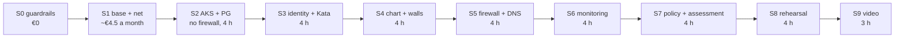

# Azure go-live

Nothing in Azure exists yet. The Terraform in `infra/` is validated and tested with mock providers in CI (`iac-*` jobs), never applied. This page is the plan for bringing it up in short sessions and taking it down again after each one: what each session builds and proves, what it costs, where the owner has to decide or click, and how to make sure nothing is left running.

Labels: ✓ checked in the linked source, ~ from memory or not re-checked, ✎ my own choice.

## Three stacks, three resource groups

| Stack | Resource group | Who applies it | Lifetime |
|---|---|---|---|
| `infra/base` | `rg-base` (also creates the empty `rg-net` and `rg-lab`) | the owner, by hand, signed in as himself | permanent: state storage, ACR Basic, Log Analytics with a daily cap, Key Vault per workload, budgets, Azure Policy, the CI identities |
| `infra/net` | `rg-net` | CI: `tf-plan` then `tf-apply`, by hand | per session: hub and spoke VNets, peering, NSGs, private DNS zones, DNS security policy |
| `infra/lab` | `rg-lab` (the firewall goes in `rg-net`, it must share the hub VNet's group) | CI: `tf-plan` then `tf-apply`, by hand | per session: AKS, PostgreSQL with its private endpoint, Firewall Basic and its route table, managed identities, diagnostic settings, alerts |

`infra/base` is never applied in CI, on purpose. The CI identities live in it (`infra/base/ci-identities.tf`), and none of them has Microsoft Graph rights or Contributor on `rg-base`. `ci-plan` reads the subscription and the state; `ci-push` may push to the registry; `ci-apply` has Contributor on `rg-net` and `rg-lab`, Monitoring Contributor on `rg-base` (for diagnostic settings and alerts), and a role-assignment right on the registry and the vaults that can hand out only a short list of roles. So a pipeline cannot create or widen its own identities, change a budget or a policy, or delete the registry, the vaults or the state. Only the owner can, from his own signed-in session.

## Sessions

Each session ends with the destroy routine below. € is the estimate from the cost table for the hours shown.



| Session | Builds | Settings | Proof at the end | Hours | € |
|---|---|---|---|---|---|
| S0 | Pay-as-you-go subscription (decision 10), Entra security defaults (MFA for every account), a break-glass account, a daily account that is not Owner, quota check for Dalsv6 in North Europe, resource providers registered. In GitLab: **Public pipelines off** (see below), then the project variables | none in Azure | screenshots of the settings; `az vm list-usage --location northeurope` shows room for the Dalsv6 vCPUs | 1 | 0 |
| S1 | The owner applies `infra/base` by hand, moves its state into the new storage account, sets `AZURE_ENABLED`; then `tf-plan` and `tf-apply` for `infra/net` from CI | `dns_block_mode = false` | a plan with no stored secret (OIDC only); budgets visible in Cost Management | 1 | ~€4.5 a month from here on |
| S2 | `infra/lab`: AKS (Entra only, local accounts off, Cilium, OIDC issuer, authorized IP ranges), PostgreSQL B1ms behind the private endpoint | `enable_firewall = false`, `sandbox_node_count = 0`, `aks_admin_group_object_ids` set | `kubectl` works only through Entra from the owner's IP; PostgreSQL does not answer from outside | 4 | ~2.0 |
| S3 | Workload identities, Key Vault + CSI, db-migrate as the PostgreSQL Entra admin setting a password per role, Kata sandbox pool on | `sandbox_node_count = 1` | a tool reads its password from the mounted secret; `uname -r` inside a Kata pod differs from the node ✓ ([AKS Pod Sandboxing](https://learn.microsoft.com/en-us/azure/aks/use-pod-sandboxing)) | 4 | ~2.8 |
| S4 | The chart with every policy, the gateway, risk engine, console, llm-gateway (Foundry or the Anthropic API) | `llm.backend`, `foundry_enabled` if Foundry | the probe matrix and the attack replay green in the cluster; console sign-in with Entra | 4 | ~2.8 + model tokens |
| S5 | Firewall Basic, route table (all AKS egress through it), DNS security policy | `enable_firewall = true`; `dns_block_mode = true` only after this session's query log shows the allowlist is complete | `curl` and DNS exfiltration fail; a Log Analytics row for each | 4 | ~4.2 |
| S6 | Container logs, diagnostic settings, the four alert rules, Defender for Containers trial | `defender_enabled = true` (trial) | stop the executor, the `heartbeat-missing` alert e-mail arrives; an attack ticket raises `attack-events` | 4 | ~4.2 (+0.10/h after the trial) |
| S7 | Azure Policy findings, the permission assessment with the `azure` plane (role assignments) | none | a role assignment added by hand turns the assessment red, removed it is green | 4 | ~4.2 |
| S8 | Everything from a clean apply | all on | `reports/evidence.html` with the Log Analytics rows (`reports/kql/`) | 4 | ~4.2 |
| S9 | Record the video | all on | the video | 3 | ~3.2 |

Total for S2 to S9, 31 hours: about €28, plus the model tokens, plus about €4.5 a month for `rg-base` while it exists. With a third on top for failed applies and reruns, about €40 for the compute, €50 to €55 with three months of `rg-base`. The budgets (decision 10) are €20 and €50 a month and only send e-mails: at 50 % and 100 % of actual spend and at 100 % of forecast. They do not stop anything.

## Before the first Azure job: Public pipelines off

The project is public on GitLab, and job logs of a public project are public by default. `tf-apply` prints the resource ids it creates (subscription id, resource names, IP addresses). The plan jobs already log only change counts and keep their plan files as artifacts that only Developers and above may download (`artifacts:access: developer`), but an apply log cannot be hidden that way. So in S0, before `AZURE_ENABLED` is set, the owner turns off **Public pipelines** in the project's Settings > CI/CD > General pipelines ~ (the setting's place in the menu is from memory). Pipelines and job logs are then visible to project members only.

## Approval points

Every step that creates, changes or removes something billable waits for the owner. Nothing runs on a push.

| Where | What the owner does |
|---|---|
| `infra/base` | applies it himself, signed in; reads the plan first |
| GitLab settings | turns Public pipelines off (S0), then sets `AZURE_ENABLED=true` and the other project variables ([pipeline.md](pipeline.md#azure-jobs)) |
| `tf-plan` | starts it by hand, reads the change counts in the log and the plan file (Developer access) |
| `tf-apply` | starts it by hand, on `main` only; it runs the plan files of the same pipeline and never plans again, and it stops before `lab` when `net` changed |
| Cluster access | sets `aks_admin_group_object_ids` (an Entra group with himself in it) and `api_authorized_ip_ranges`. The default list is empty: with local accounts off, nobody can use the cluster API until it is set |
| Cost switches | `enable_firewall` (€0.35/h), `sandbox_node_count` (0 or 1), `defender_enabled`, `foundry_enabled`, `dns_block_mode` |
| Destroy | `tf-destroy-plan`, then `tf-destroy`, then `leftover-check`, all by hand, at the end of every session |
| Money outside Azure | an Anthropic API key or Foundry deployment for the real model (decision 7); the scripted model costs nothing |

## Destroy routine

At the end of every session:

1. Run `tf-destroy-plan` (reader identity). It writes destroy plans for `infra/lab` and then `infra/net`, and stops if a state manages a resource group.
2. Read what it would remove.
3. Run `tf-destroy` (`main` only). It checks both states again, then runs exactly those saved plans, lab first. Only what the two stacks created goes: never `infra/base`, never the resource groups themselves.
4. Run `leftover-check`. It lists everything still in `rg-lab`, and every resource of a billable type anywhere in the subscription (clusters, firewalls, PostgreSQL servers, public IPs, private endpoints, load balancers, NAT gateways, VMs and scale sets, disks), and fails with the list if there is any. The AKS node resource group is covered by the type list.
5. The next day, check Cost Management for the session's real cost. The budget e-mails are the backstop if a step was skipped.

To check by hand, as a reader:

```sh
az resource list --resource-group rg-lab --output table
az resource list --resource-group rg-net --output table
az resource list --resource-type Microsoft.ContainerService/managedClusters --output table
az resource list --resource-type Microsoft.Network/azureFirewalls --output table
```

`rg-lab` must be empty, `rg-net` too after a full destroy. `rg-base` keeps the registry, the workspace, the vaults and the state.

## Costs

Every unit price comes from the public [Azure Retail Prices API](https://learn.microsoft.com/en-us/rest/api/cost-management/retail-prices/azure-retail-prices) (`https://prices.azure.com/api/retail/prices`, no sign-in), queried on 2026-10-17 at 19:06 UTC with `currencyCode=EUR` and `armRegionName eq 'northeurope'` (the ACNS meter is global), Linux, pay-as-you-go. ✓ on a price means I read that meter; ~ means the price or the quantity is an estimate.

### Per hour while the lab exists

| Item | Meter | Unit price | Quantity | €/h |
|---|---|---|---|---|
| System pool, Standard_D4als_v6 | Dalsv6 Series, D4als v6 ✓ | €0.1575/h | 2 | 0.315 |
| Sandbox pool, Standard_D4als_v6 | same ✓ | €0.1575/h | 1 (0 in S2) | 0.158 |
| Node OS disks | Premium SSD P10 LRS ✓ €17.34/month | ~€0.024/h | 3; the 128 GB P10 size is the AKS default ~ | ~0.071 |
| AKS control plane, Free tier | no charge for Free ✓; a meter "FreeTierInfrastructureCost Uptime SLA" at €0.044/h appears from 2026-10-01 ✓, and whether it bills a Free cluster I could not confirm ~ | €0 or €0.044/h | 1 | 0 to 0.044 |
| Advanced Container Networking Services | Standard Node ✓ (global) | €0.022/node-h | 3 | 0.066 |
| PostgreSQL Flexible B1ms | Burstable B1MS ✓ | €0.0158/h | 1 | 0.016 |
| PostgreSQL storage, 32 GB | Flex Server Storage ✓ €0.1113/GB-month | | 32 GB | 0.005 |
| Private endpoint for PostgreSQL | not found in the price list under the names I tried ~ | ~€0.01/h | 1 | ~0.01 |
| Standard load balancer of AKS | Standard Included LB Rules ✓ (global) | €0.022/h | 1 ~ | 0.022 |
| Outbound public IP (firewall off only) | Standard IPv4 Static ✓ | €0.0044/h | 1 | 0.004 |
| **Without the firewall** | | | | **~€0.67 to €0.71** |
| Firewall Basic | Basic Deployment ✓ | €0.3476/h | 1 | 0.348 |
| Firewall data | Basic Data Processed ✓ | €0.0572/GB | a few GB a session ~ | ~0.01 |
| Firewall public IPs (data and management) | Standard IPv4 Static ✓ | €0.0044/h | 2, replacing the outbound IP | +0.004 |
| **With the firewall** | | | | **~€1.03 to €1.07** |
| Defender for Containers, after the trial | Standard vCore ✓ | €0.0083/vCore-h | 12 vCores | 0.10 |

With `sandbox_node_count = 0` the sandbox node, its disk and its ACNS meter go: about €0.20/h less.

### Per month, `rg-base` and the rest

| Item | Meter | Price | Estimate |
|---|---|---|---|
| ACR Basic | Basic Registry Unit ✓ | €0.1466/day | €4.40 a month |
| Log Analytics | Analytics Logs Data Ingestion ✓: first 5 GB a month free, then €2.4287/GB | daily cap 0.5 GB | €0 for a few sessions; at most about €24 if the cap were hit every day of a month |
| Key Vault operations | Standard Operations ✓ | €0.0264 per 10 000 | ~€0 |
| State storage | Hot LRS Block Blob ✓ | €0.0194/GB-month | ~€0 |
| Private DNS zones (2, in `rg-net`) | Private Zone ✓ | €0.44 per zone-month | €0.88 a month while `rg-net` has them |
| DNS security policy | DNS Security Policy Queries ✓ €0.528 per million; Managed Domain ✓ €0.44 | | ~€0.5 a month while it exists |
| Log alert rules (4, in `rg-lab`) | Alerts System Log Monitored at 15 Minute Frequency ✓ | €0.44 per rule-month | cents per session |
| Budgets, Azure Policy, VNets, NSGs, peering in one region | | no charge ~ | 0 |

What it does not include: model tokens (the scripted model is free; the demo model is `claude-haiku-5-5`, decision 7, priced by the provider, not checked here ~), data out of Azure, and tax.

## Not protected yet

- ACR Basic has no dedicated data endpoints, so layer downloads are redirected to `*.blob.core.windows.net` and the firewall has to allow that wildcard, which reaches every storage account in Azure ✓ ([dedicated data endpoints](https://learn.microsoft.com/en-us/azure/container-registry/container-registry-dedicated-data-endpoints)). The pods cannot use it (their egress is the chart's policies), but anything on a node can. ACR Premium (€1.47 a day ✓) with dedicated data endpoints, or a private endpoint, would close it.
- The Free-tier meter above: if it bills, each session costs €0.044/h more than the low estimate.
- The other gaps (outside calls at most once, held move-outs, local alerts, agent Job edges) are listed in [architecture.md](architecture.md#not-protected-yet).
