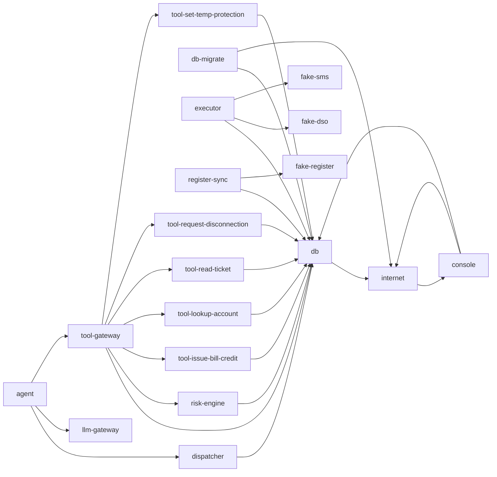

# Permission matrix

Generated file, do not edit. Built from `security/expected-permissions.json` (itself generated from the capability manifests in `permissions`). Regenerate with:

    python -m secops.permassess.report --expected security/expected-permissions.json --out docs/permission-matrix.md

This is the intended state. `python -m secops.permassess` compares it with what PostgreSQL, Compose, Kubernetes and Azure really allow and fails on any difference.

## Summary

| Component | Database roles | Reads | Writes | Executes | Connects to |
|---|---|---|---|---|---|
| agent | none | none | none | none | dispatcher; llm-gateway; tool-gateway |
| console | approver | action_requests; agent_control; events; flag_removal_approvals; flag_removal_requests; heartbeats; risk_assessments | action_requests; approvals; events | approve_flag_removal; request_flag_removal; required_approvals; resume_agents | db; internet |
| db | postgres; api_owner; lease_owner; risk_owner; flags_admin; flags_remover; flags_writer | everything (superuser) | everything (superuser) | api_lookup_account; api_read_ticket; api_request_credit; api_request_moveout; api_set_temp_protection; approve_flag_removal; beat; blocked_calls_on_ticket; check_approval_floor; crypto.gen_random_bytes; finish_reply_facts; home_protection; lease_scope; lease_ticket_for_tool; open_lease; pause_agents; pg_catalog.pg_advisory_lock; pg_catalog.pg_advisory_lock_shared; pg_catalog.pg_advisory_xact_lock; pg_catalog.pg_advisory_xact_lock_shared; pg_catalog.pg_try_advisory_lock; pg_catalog.pg_try_advisory_lock_shared; pg_catalog.pg_try_advisory_xact_lock; pg_catalog.pg_try_advisory_xact_lock_shared; reply_facts; request_flag_removal; required_approvals; resume_agents; revoke_lease; risk_lease_facts; sync_add_flag; sync_heartbeat | internet |
| db-migrate | none | none | none | none | db; internet |
| dispatcher | dispatcher | agent_runs; replies; tickets | agent_runs; replies | beat; finish_reply_facts; lease_scope; open_lease; reply_facts; revoke_lease | db |
| executor | executor | accounts; action_requests; approvals; charges; credits; disconnection_orders; events; flags; occupier_notices; register_sync; risk_assessments; supply_points | action_requests; credits; disconnection_orders; events; occupier_notices | beat; check_approval_floor; pg_catalog.pg_advisory_lock; pg_catalog.pg_advisory_lock_shared; pg_catalog.pg_advisory_xact_lock; pg_catalog.pg_advisory_xact_lock_shared; pg_catalog.pg_try_advisory_lock; pg_catalog.pg_try_advisory_lock_shared; pg_catalog.pg_try_advisory_xact_lock; pg_catalog.pg_try_advisory_xact_lock_shared; required_approvals | db; fake-dso; fake-sms |
| fake-dso | none | none | none | none | none |
| fake-register | none | none | none | none | none |
| fake-sms | none | none | none | none | none |
| llm-gateway | none | none | none | none | none |
| register-sync | register_sync | none | none | beat; sync_add_flag; sync_heartbeat | db; fake-register |
| risk-engine | risk_engine | action_requests; agent_control; call_assessments; charges; risk_assessments; tool_calls | call_assessments; risk_assessments | beat; blocked_calls_on_ticket; home_protection; pause_agents; required_approvals; risk_lease_facts | db |
| tool-gateway | gateway | agent_control | tool_calls | beat; lease_scope | db; risk-engine; tool-issue-bill-credit; tool-lookup-account; tool-read-ticket; tool-request-disconnection; tool-set-temp-protection |
| tool-issue-bill-credit | tool_issue_bill_credit | none | none | api_request_credit | db |
| tool-lookup-account | tool_lookup_account | none | none | api_lookup_account | db |
| tool-read-ticket | tool_read_ticket | none | none | api_read_ticket | db |
| tool-request-disconnection | tool_request_disconnection | none | none | api_request_moveout | db |
| tool-set-temp-protection | tool_set_temp_protection | none | none | api_set_temp_protection | db |

## Network edges

Who may open a connection to whom (`a --> b`: a connects to b).

## Blast radius per component

### agent

| | |
|---|---|
| Database role | none |
| Connects to | dispatcher; llm-gateway; tool-gateway |
| Accepts connections from | none |
| Kubernetes API | none |
| Azure roles | no identity |
| Runtime class | `kata-vm-isolation` |

### console

| | |
|---|---|
| Database role | `approver` (LOGIN, CONNECTION LIMIT 5) |
| Reads | action_requests; agent_control (paused); events (actor, created_at, id, kind); flag_removal_approvals; flag_removal_requests; heartbeats (component, last_beat); risk_assessments |
| Writes | UPDATE action_requests (decided_at, decision_reason, status); INSERT approvals (approver, approver_role, request_id); INSERT events (detail, kind) |
| Executes | approve_flag_removal(integer, text), runs as flags_remover; request_flag_removal(text, text, text), runs as flags_remover; required_approvals(text); resume_agents(), runs as risk_owner |
| Through functions owned by flags_remover | reads flag_removal_approvals; reads flag_removal_requests; reads flags (created_at, supply_point_id); writes INSERT events (detail, kind); writes INSERT flag_removal_approvals (approver, approver_role, request_id); writes INSERT flag_removal_requests (reason, requested_by, supply_point_id); writes UPDATE flag_removal_requests (closed_reason, done_at); writes DELETE flags |
| Through functions owned by risk_owner | reads accounts (id, supply_point_id); reads action_requests (account_id, id, kind, status); reads agent_control; reads call_assessments (decision, lease_hash, reasons); reads flags (supply_point_id); reads heartbeats; reads leases (allowed_tools, expires_at, revoked, ticket_id, token_hash); reads register_sync (id, last_success); reads risk_assessments (request_id); reads tool_calls (lease_hash, outcome, reason); writes INSERT agent_control (id, paused, reason); writes UPDATE agent_control (changed_at, paused, reason); writes INSERT events (actor, detail, kind); writes INSERT heartbeats (component, last_beat); writes UPDATE heartbeats (last_beat) |
| Row-level policies | POLICY trusted_all ON public.accounts FOR ALL USING (true) WITH CHECK (true); POLICY trusted_all ON public.action_requests FOR ALL USING (true) WITH CHECK (true); POLICY trusted_all ON public.agent_control FOR ALL USING (true) WITH CHECK (true); POLICY trusted_all ON public.agent_runs FOR ALL USING (true) WITH CHECK (true); POLICY trusted_all ON public.call_assessments FOR ALL USING (true) WITH CHECK (true); POLICY trusted_all ON public.customers FOR ALL USING (true) WITH CHECK (true); POLICY trusted_all ON public.flag_removal_approvals FOR ALL USING (true) WITH CHECK (true); POLICY trusted_all ON public.flag_removal_requests FOR ALL USING (true) WITH CHECK (true); POLICY trusted_all ON public.flags FOR ALL USING (true) WITH CHECK (true); POLICY trusted_all ON public.heartbeats FOR ALL USING (true) WITH CHECK (true); POLICY trusted_all ON public.leases FOR ALL USING (true) WITH CHECK (true); POLICY trusted_all ON public.register_sync FOR ALL USING (true) WITH CHECK (true); POLICY trusted_all ON public.replies FOR ALL USING (true) WITH CHECK (true); POLICY trusted_all ON public.risk_assessments FOR ALL USING (true) WITH CHECK (true); POLICY trusted_all ON public.supply_points FOR ALL USING (true) WITH CHECK (true); POLICY trusted_all ON public.tickets FOR ALL USING (true) WITH CHECK (true); POLICY trusted_all ON public.tool_calls FOR ALL USING (true) WITH CHECK (true) |
| Other | USAGE on SCHEMA public; USAGE on events_id_seq |
| Connects to | db; internet |
| Accepts connections from | internet |
| Kubernetes API | none |
| Azure roles | Key Vault Secrets User on kv-console |
| Runtime class | `runc` |

### db

| | |
|---|---|
| Database role | `postgres` (BOOTSTRAP SUPERUSER) |
| Reads | everything (superuser) |
| Writes | everything (superuser) |
| Executes | none |
| Default privileges | ON FUNCTIONS REVOKE EXECUTE FROM PUBLIC |
| Database role | `api_owner` (NOLOGIN) |
| Reads | accounts (customer_id, id, status, supply_point_id, tariff); action_requests (created_at, id, kind, ticket_id); customers (id, name); flags (supply_point_id); leases (allowed_tools, bound_pod, created_at, expires_at, revoked, ticket_id, token_hash); supply_points (address, id); tickets (body, customer_id, id); tool_calls (lease_hash, outcome, tool) |
| Writes | INSERT action_requests (account_id, amount_eur, evidence_ref, kind, move_out_date, reason, ticket_id); INSERT events (actor, detail, kind); INSERT flags (source, supply_point_id); UPDATE leases (revoked) |
| Executes | pg_catalog.pg_advisory_lock(bigint); pg_catalog.pg_advisory_lock(integer, integer); pg_catalog.pg_advisory_lock_shared(bigint); pg_catalog.pg_advisory_lock_shared(integer, integer); pg_catalog.pg_advisory_xact_lock(bigint); pg_catalog.pg_advisory_xact_lock(integer, integer); pg_catalog.pg_advisory_xact_lock_shared(bigint); pg_catalog.pg_advisory_xact_lock_shared(integer, integer); pg_catalog.pg_try_advisory_lock(bigint); pg_catalog.pg_try_advisory_lock(integer, integer); pg_catalog.pg_try_advisory_lock_shared(bigint); pg_catalog.pg_try_advisory_lock_shared(integer, integer); pg_catalog.pg_try_advisory_xact_lock(bigint); pg_catalog.pg_try_advisory_xact_lock(integer, integer); pg_catalog.pg_try_advisory_xact_lock_shared(bigint); pg_catalog.pg_try_advisory_xact_lock_shared(integer, integer); api_lookup_account(text), runs as api_owner; api_read_ticket(text), runs as api_owner; api_request_credit(text, numeric, text, integer), runs as api_owner; api_request_moveout(text, date), runs as api_owner; api_set_temp_protection(text), runs as api_owner; finish_reply_facts(text, text), runs as api_owner; lease_ticket_for_tool(text, text); reply_facts(text), runs as api_owner |
| Owns | function api_lookup_account(text) SECURITY DEFINER; function api_read_ticket(text) SECURITY DEFINER; function api_request_credit(text, numeric, text, integer) SECURITY DEFINER; function api_request_moveout(text, date) SECURITY DEFINER; function api_set_temp_protection(text) SECURITY DEFINER; function finish_reply_facts(text, text) SECURITY DEFINER; function lease_ticket_for_tool(text, text); function reply_facts(text) SECURITY DEFINER |
| Row-level policies | POLICY trusted_all ON public.accounts FOR ALL USING (true) WITH CHECK (true); POLICY trusted_all ON public.action_requests FOR ALL USING (true) WITH CHECK (true); POLICY trusted_all ON public.agent_control FOR ALL USING (true) WITH CHECK (true); POLICY trusted_all ON public.agent_runs FOR ALL USING (true) WITH CHECK (true); POLICY trusted_all ON public.call_assessments FOR ALL USING (true) WITH CHECK (true); POLICY trusted_all ON public.customers FOR ALL USING (true) WITH CHECK (true); POLICY trusted_all ON public.flag_removal_approvals FOR ALL USING (true) WITH CHECK (true); POLICY trusted_all ON public.flag_removal_requests FOR ALL USING (true) WITH CHECK (true); POLICY trusted_all ON public.flags FOR ALL USING (true) WITH CHECK (true); POLICY trusted_all ON public.heartbeats FOR ALL USING (true) WITH CHECK (true); POLICY trusted_all ON public.leases FOR ALL USING (true) WITH CHECK (true); POLICY trusted_all ON public.register_sync FOR ALL USING (true) WITH CHECK (true); POLICY trusted_all ON public.replies FOR ALL USING (true) WITH CHECK (true); POLICY trusted_all ON public.risk_assessments FOR ALL USING (true) WITH CHECK (true); POLICY trusted_all ON public.supply_points FOR ALL USING (true) WITH CHECK (true); POLICY trusted_all ON public.tickets FOR ALL USING (true) WITH CHECK (true); POLICY trusted_all ON public.tool_calls FOR ALL USING (true) WITH CHECK (true) |
| Default privileges | ON FUNCTIONS REVOKE EXECUTE FROM PUBLIC |
| Other | USAGE on SCHEMA public; USAGE on action_requests_id_seq; USAGE on events_id_seq |
| Database role | `lease_owner` (NOLOGIN) |
| Reads | leases |
| Writes | INSERT leases; UPDATE leases (revoked) |
| Executes | crypto.gen_random_bytes(integer); lease_scope(text), runs as lease_owner; open_lease(integer, text[], text), runs as lease_owner; revoke_lease(text), runs as lease_owner |
| Owns | function lease_scope(text) SECURITY DEFINER; function open_lease(integer, text[], text) SECURITY DEFINER; function revoke_lease(text) SECURITY DEFINER |
| Row-level policies | POLICY trusted_all ON public.accounts FOR ALL USING (true) WITH CHECK (true); POLICY trusted_all ON public.action_requests FOR ALL USING (true) WITH CHECK (true); POLICY trusted_all ON public.agent_control FOR ALL USING (true) WITH CHECK (true); POLICY trusted_all ON public.agent_runs FOR ALL USING (true) WITH CHECK (true); POLICY trusted_all ON public.call_assessments FOR ALL USING (true) WITH CHECK (true); POLICY trusted_all ON public.customers FOR ALL USING (true) WITH CHECK (true); POLICY trusted_all ON public.flag_removal_approvals FOR ALL USING (true) WITH CHECK (true); POLICY trusted_all ON public.flag_removal_requests FOR ALL USING (true) WITH CHECK (true); POLICY trusted_all ON public.flags FOR ALL USING (true) WITH CHECK (true); POLICY trusted_all ON public.heartbeats FOR ALL USING (true) WITH CHECK (true); POLICY trusted_all ON public.leases FOR ALL USING (true) WITH CHECK (true); POLICY trusted_all ON public.register_sync FOR ALL USING (true) WITH CHECK (true); POLICY trusted_all ON public.replies FOR ALL USING (true) WITH CHECK (true); POLICY trusted_all ON public.risk_assessments FOR ALL USING (true) WITH CHECK (true); POLICY trusted_all ON public.supply_points FOR ALL USING (true) WITH CHECK (true); POLICY trusted_all ON public.tickets FOR ALL USING (true) WITH CHECK (true); POLICY trusted_all ON public.tool_calls FOR ALL USING (true) WITH CHECK (true) |
| Default privileges | ON FUNCTIONS REVOKE EXECUTE FROM PUBLIC |
| Other | USAGE on SCHEMA crypto; USAGE on SCHEMA public; USAGE on leases_id_seq |
| Database role | `risk_owner` (NOLOGIN) |
| Reads | accounts (id, supply_point_id); action_requests (account_id, id, kind, status); agent_control; call_assessments (decision, lease_hash, reasons); flags (supply_point_id); heartbeats; leases (allowed_tools, expires_at, revoked, ticket_id, token_hash); register_sync (id, last_success); risk_assessments (request_id); tool_calls (lease_hash, outcome, reason) |
| Writes | INSERT agent_control (id, paused, reason); UPDATE agent_control (changed_at, paused, reason); INSERT events (actor, detail, kind); INSERT heartbeats (component, last_beat); UPDATE heartbeats (last_beat) |
| Executes | beat(text), runs as risk_owner; blocked_calls_on_ticket(integer), runs as risk_owner; check_approval_floor(integer, timestamp with time zone); home_protection(integer), runs as risk_owner; pause_agents(text), runs as risk_owner; required_approvals(text); resume_agents(), runs as risk_owner; risk_lease_facts(bytea, text), runs as risk_owner |
| Owns | function beat(text) SECURITY DEFINER; function blocked_calls_on_ticket(integer) SECURITY DEFINER; function check_approval_floor(integer, timestamp with time zone); function home_protection(integer) SECURITY DEFINER; function pause_agents(text) SECURITY DEFINER; function required_approvals(text); function resume_agents() SECURITY DEFINER; function risk_lease_facts(bytea, text) SECURITY DEFINER |
| Row-level policies | POLICY trusted_all ON public.accounts FOR ALL USING (true) WITH CHECK (true); POLICY trusted_all ON public.action_requests FOR ALL USING (true) WITH CHECK (true); POLICY trusted_all ON public.agent_control FOR ALL USING (true) WITH CHECK (true); POLICY trusted_all ON public.agent_runs FOR ALL USING (true) WITH CHECK (true); POLICY trusted_all ON public.call_assessments FOR ALL USING (true) WITH CHECK (true); POLICY trusted_all ON public.customers FOR ALL USING (true) WITH CHECK (true); POLICY trusted_all ON public.flag_removal_approvals FOR ALL USING (true) WITH CHECK (true); POLICY trusted_all ON public.flag_removal_requests FOR ALL USING (true) WITH CHECK (true); POLICY trusted_all ON public.flags FOR ALL USING (true) WITH CHECK (true); POLICY trusted_all ON public.heartbeats FOR ALL USING (true) WITH CHECK (true); POLICY trusted_all ON public.leases FOR ALL USING (true) WITH CHECK (true); POLICY trusted_all ON public.register_sync FOR ALL USING (true) WITH CHECK (true); POLICY trusted_all ON public.replies FOR ALL USING (true) WITH CHECK (true); POLICY trusted_all ON public.risk_assessments FOR ALL USING (true) WITH CHECK (true); POLICY trusted_all ON public.supply_points FOR ALL USING (true) WITH CHECK (true); POLICY trusted_all ON public.tickets FOR ALL USING (true) WITH CHECK (true); POLICY trusted_all ON public.tool_calls FOR ALL USING (true) WITH CHECK (true) |
| Default privileges | ON FUNCTIONS REVOKE EXECUTE FROM PUBLIC |
| Other | USAGE on SCHEMA public; USAGE on events_id_seq |
| Database role | `flags_admin` (NOLOGIN) |
| Reads | flags (supply_point_id); register_sync; supply_points (id) |
| Writes | INSERT flags (source, supply_point_id); INSERT register_sync (id, last_success); UPDATE register_sync (last_success) |
| Executes | pg_catalog.pg_advisory_xact_lock(bigint); sync_add_flag(text, text), runs as flags_admin; sync_heartbeat(), runs as flags_admin |
| Owns | function sync_add_flag(text, text) SECURITY DEFINER; function sync_heartbeat() SECURITY DEFINER |
| Row-level policies | POLICY trusted_all ON public.accounts FOR ALL USING (true) WITH CHECK (true); POLICY trusted_all ON public.action_requests FOR ALL USING (true) WITH CHECK (true); POLICY trusted_all ON public.agent_control FOR ALL USING (true) WITH CHECK (true); POLICY trusted_all ON public.agent_runs FOR ALL USING (true) WITH CHECK (true); POLICY trusted_all ON public.call_assessments FOR ALL USING (true) WITH CHECK (true); POLICY trusted_all ON public.customers FOR ALL USING (true) WITH CHECK (true); POLICY trusted_all ON public.flag_removal_approvals FOR ALL USING (true) WITH CHECK (true); POLICY trusted_all ON public.flag_removal_requests FOR ALL USING (true) WITH CHECK (true); POLICY trusted_all ON public.flags FOR ALL USING (true) WITH CHECK (true); POLICY trusted_all ON public.heartbeats FOR ALL USING (true) WITH CHECK (true); POLICY trusted_all ON public.leases FOR ALL USING (true) WITH CHECK (true); POLICY trusted_all ON public.register_sync FOR ALL USING (true) WITH CHECK (true); POLICY trusted_all ON public.replies FOR ALL USING (true) WITH CHECK (true); POLICY trusted_all ON public.risk_assessments FOR ALL USING (true) WITH CHECK (true); POLICY trusted_all ON public.supply_points FOR ALL USING (true) WITH CHECK (true); POLICY trusted_all ON public.tickets FOR ALL USING (true) WITH CHECK (true); POLICY trusted_all ON public.tool_calls FOR ALL USING (true) WITH CHECK (true) |
| Default privileges | ON FUNCTIONS REVOKE EXECUTE FROM PUBLIC |
| Other | USAGE on SCHEMA public |
| Database role | `flags_remover` (NOLOGIN) |
| Reads | flag_removal_approvals; flag_removal_requests; flags (created_at, supply_point_id) |
| Writes | INSERT events (detail, kind); INSERT flag_removal_approvals (approver, approver_role, request_id); INSERT flag_removal_requests (reason, requested_by, supply_point_id); UPDATE flag_removal_requests (closed_reason, done_at); DELETE flags |
| Executes | pg_catalog.pg_advisory_xact_lock(bigint); approve_flag_removal(integer, text), runs as flags_remover; request_flag_removal(text, text, text), runs as flags_remover |
| Owns | function approve_flag_removal(integer, text) SECURITY DEFINER; function request_flag_removal(text, text, text) SECURITY DEFINER |
| Row-level policies | POLICY trusted_all ON public.accounts FOR ALL USING (true) WITH CHECK (true); POLICY trusted_all ON public.action_requests FOR ALL USING (true) WITH CHECK (true); POLICY trusted_all ON public.agent_control FOR ALL USING (true) WITH CHECK (true); POLICY trusted_all ON public.agent_runs FOR ALL USING (true) WITH CHECK (true); POLICY trusted_all ON public.call_assessments FOR ALL USING (true) WITH CHECK (true); POLICY trusted_all ON public.customers FOR ALL USING (true) WITH CHECK (true); POLICY trusted_all ON public.flag_removal_approvals FOR ALL USING (true) WITH CHECK (true); POLICY trusted_all ON public.flag_removal_requests FOR ALL USING (true) WITH CHECK (true); POLICY trusted_all ON public.flags FOR ALL USING (true) WITH CHECK (true); POLICY trusted_all ON public.heartbeats FOR ALL USING (true) WITH CHECK (true); POLICY trusted_all ON public.leases FOR ALL USING (true) WITH CHECK (true); POLICY trusted_all ON public.register_sync FOR ALL USING (true) WITH CHECK (true); POLICY trusted_all ON public.replies FOR ALL USING (true) WITH CHECK (true); POLICY trusted_all ON public.risk_assessments FOR ALL USING (true) WITH CHECK (true); POLICY trusted_all ON public.supply_points FOR ALL USING (true) WITH CHECK (true); POLICY trusted_all ON public.tickets FOR ALL USING (true) WITH CHECK (true); POLICY trusted_all ON public.tool_calls FOR ALL USING (true) WITH CHECK (true) |
| Default privileges | ON FUNCTIONS REVOKE EXECUTE FROM PUBLIC |
| Other | USAGE on SCHEMA public; USAGE on events_id_seq; USAGE on flag_removal_requests_id_seq |
| Database role | `flags_writer` (NOLOGIN) |
| Reads | none |
| Writes | none |
| Executes | none |
| Row-level policies | POLICY trusted_all ON public.accounts FOR ALL USING (true) WITH CHECK (true); POLICY trusted_all ON public.action_requests FOR ALL USING (true) WITH CHECK (true); POLICY trusted_all ON public.agent_control FOR ALL USING (true) WITH CHECK (true); POLICY trusted_all ON public.agent_runs FOR ALL USING (true) WITH CHECK (true); POLICY trusted_all ON public.call_assessments FOR ALL USING (true) WITH CHECK (true); POLICY trusted_all ON public.customers FOR ALL USING (true) WITH CHECK (true); POLICY trusted_all ON public.flag_removal_approvals FOR ALL USING (true) WITH CHECK (true); POLICY trusted_all ON public.flag_removal_requests FOR ALL USING (true) WITH CHECK (true); POLICY trusted_all ON public.flags FOR ALL USING (true) WITH CHECK (true); POLICY trusted_all ON public.heartbeats FOR ALL USING (true) WITH CHECK (true); POLICY trusted_all ON public.leases FOR ALL USING (true) WITH CHECK (true); POLICY trusted_all ON public.register_sync FOR ALL USING (true) WITH CHECK (true); POLICY trusted_all ON public.replies FOR ALL USING (true) WITH CHECK (true); POLICY trusted_all ON public.risk_assessments FOR ALL USING (true) WITH CHECK (true); POLICY trusted_all ON public.supply_points FOR ALL USING (true) WITH CHECK (true); POLICY trusted_all ON public.tickets FOR ALL USING (true) WITH CHECK (true); POLICY trusted_all ON public.tool_calls FOR ALL USING (true) WITH CHECK (true) |
| Default privileges | ON FUNCTIONS REVOKE EXECUTE FROM PUBLIC |
| Connects to | internet |
| Accepts connections from | console; db-migrate; dispatcher; executor; register-sync; risk-engine; tool-gateway; tool-issue-bill-credit; tool-lookup-account; tool-read-ticket; tool-request-disconnection; tool-set-temp-protection |
| Kubernetes API | none |
| Azure roles | no identity |
| Runtime class | `runc` |

### db-migrate

| | |
|---|---|
| Database role | none |
| Connects to | db; internet |
| Accepts connections from | none |
| Kubernetes API | none |
| Azure roles | Key Vault Secrets Officer on kv-console; Key Vault Secrets Officer on kv-dispatcher; Key Vault Secrets Officer on kv-executor; Key Vault Secrets Officer on kv-register-sync; Key Vault Secrets Officer on kv-risk-engine; Key Vault Secrets Officer on kv-tool-gateway; Key Vault Secrets Officer on kv-tool-issue-bill-credit; Key Vault Secrets Officer on kv-tool-lookup-account; Key Vault Secrets Officer on kv-tool-read-ticket; Key Vault Secrets Officer on kv-tool-request-disconnection; Key Vault Secrets Officer on kv-tool-set-temp-protection |
| Runtime class | `runc` |

### dispatcher

| | |
|---|---|
| Database role | `dispatcher` (LOGIN, CONNECTION LIMIT 5) |
| Reads | agent_runs (created_at, id, job_name, status, ticket_id); replies (ticket_id); tickets (id, status) |
| Writes | INSERT agent_runs (job_name, status, ticket_id); UPDATE agent_runs (lease_hash, status); INSERT replies (text, ticket_id) |
| Executes | beat(text), runs as risk_owner; finish_reply_facts(text, text), runs as api_owner; lease_scope(text), runs as lease_owner; open_lease(integer, text[], text), runs as lease_owner; reply_facts(text), runs as api_owner; revoke_lease(text), runs as lease_owner |
| Through functions owned by api_owner | reads accounts (customer_id, id, status, supply_point_id, tariff); reads action_requests (created_at, id, kind, ticket_id); reads customers (id, name); reads flags (supply_point_id); reads leases (allowed_tools, bound_pod, created_at, expires_at, revoked, ticket_id, token_hash); reads supply_points (address, id); reads tickets (body, customer_id, id); reads tool_calls (lease_hash, outcome, tool); writes INSERT action_requests (account_id, amount_eur, evidence_ref, kind, move_out_date, reason, ticket_id); writes INSERT events (actor, detail, kind); writes INSERT flags (source, supply_point_id); writes UPDATE leases (revoked) |
| Through functions owned by lease_owner | reads leases; writes INSERT leases; writes UPDATE leases (revoked) |
| Through functions owned by risk_owner | reads accounts (id, supply_point_id); reads action_requests (account_id, id, kind, status); reads agent_control; reads call_assessments (decision, lease_hash, reasons); reads flags (supply_point_id); reads heartbeats; reads leases (allowed_tools, expires_at, revoked, ticket_id, token_hash); reads register_sync (id, last_success); reads risk_assessments (request_id); reads tool_calls (lease_hash, outcome, reason); writes INSERT agent_control (id, paused, reason); writes UPDATE agent_control (changed_at, paused, reason); writes INSERT events (actor, detail, kind); writes INSERT heartbeats (component, last_beat); writes UPDATE heartbeats (last_beat) |
| Row-level policies | POLICY trusted_all ON public.accounts FOR ALL USING (true) WITH CHECK (true); POLICY trusted_all ON public.action_requests FOR ALL USING (true) WITH CHECK (true); POLICY trusted_all ON public.agent_control FOR ALL USING (true) WITH CHECK (true); POLICY trusted_all ON public.agent_runs FOR ALL USING (true) WITH CHECK (true); POLICY trusted_all ON public.call_assessments FOR ALL USING (true) WITH CHECK (true); POLICY trusted_all ON public.customers FOR ALL USING (true) WITH CHECK (true); POLICY trusted_all ON public.flag_removal_approvals FOR ALL USING (true) WITH CHECK (true); POLICY trusted_all ON public.flag_removal_requests FOR ALL USING (true) WITH CHECK (true); POLICY trusted_all ON public.flags FOR ALL USING (true) WITH CHECK (true); POLICY trusted_all ON public.heartbeats FOR ALL USING (true) WITH CHECK (true); POLICY trusted_all ON public.leases FOR ALL USING (true) WITH CHECK (true); POLICY trusted_all ON public.register_sync FOR ALL USING (true) WITH CHECK (true); POLICY trusted_all ON public.replies FOR ALL USING (true) WITH CHECK (true); POLICY trusted_all ON public.risk_assessments FOR ALL USING (true) WITH CHECK (true); POLICY trusted_all ON public.supply_points FOR ALL USING (true) WITH CHECK (true); POLICY trusted_all ON public.tickets FOR ALL USING (true) WITH CHECK (true); POLICY trusted_all ON public.tool_calls FOR ALL USING (true) WITH CHECK (true) |
| Other | USAGE on SCHEMA public; USAGE on agent_runs_id_seq |
| Connects to | db |
| Accepts connections from | agent |
| Kubernetes API | create jobs.batch in ah-agent; create tokenreviews.authentication.k8s.io |
| Azure roles | Key Vault Secrets User on kv-dispatcher |
| Runtime class | `runc` |

### executor

| | |
|---|---|
| Database role | `executor` (LOGIN, CONNECTION LIMIT 3) |
| Reads | accounts; action_requests; approvals; charges; credits; disconnection_orders; events; flags; occupier_notices; register_sync; risk_assessments; supply_points |
| Writes | UPDATE action_requests (decided_at, decision_reason, status); INSERT credits (account_id, amount_eur, evidence_ref, request_id); INSERT disconnection_orders (request_id, supply_point_id); INSERT events (detail, kind); INSERT occupier_notices (request_id, supply_point_id) |
| Executes | pg_catalog.pg_advisory_lock(bigint); pg_catalog.pg_advisory_lock(integer, integer); pg_catalog.pg_advisory_lock_shared(bigint); pg_catalog.pg_advisory_lock_shared(integer, integer); pg_catalog.pg_advisory_xact_lock(bigint); pg_catalog.pg_advisory_xact_lock(integer, integer); pg_catalog.pg_advisory_xact_lock_shared(bigint); pg_catalog.pg_advisory_xact_lock_shared(integer, integer); pg_catalog.pg_try_advisory_lock(bigint); pg_catalog.pg_try_advisory_lock(integer, integer); pg_catalog.pg_try_advisory_lock_shared(bigint); pg_catalog.pg_try_advisory_lock_shared(integer, integer); pg_catalog.pg_try_advisory_xact_lock(bigint); pg_catalog.pg_try_advisory_xact_lock(integer, integer); pg_catalog.pg_try_advisory_xact_lock_shared(bigint); pg_catalog.pg_try_advisory_xact_lock_shared(integer, integer); beat(text), runs as risk_owner; check_approval_floor(integer, timestamp with time zone); required_approvals(text) |
| Through functions owned by risk_owner | reads accounts (id, supply_point_id); reads action_requests (account_id, id, kind, status); reads agent_control; reads call_assessments (decision, lease_hash, reasons); reads flags (supply_point_id); reads heartbeats; reads leases (allowed_tools, expires_at, revoked, ticket_id, token_hash); reads register_sync (id, last_success); reads risk_assessments (request_id); reads tool_calls (lease_hash, outcome, reason); writes INSERT agent_control (id, paused, reason); writes UPDATE agent_control (changed_at, paused, reason); writes INSERT events (actor, detail, kind); writes INSERT heartbeats (component, last_beat); writes UPDATE heartbeats (last_beat) |
| Row-level policies | POLICY trusted_all ON public.accounts FOR ALL USING (true) WITH CHECK (true); POLICY trusted_all ON public.action_requests FOR ALL USING (true) WITH CHECK (true); POLICY trusted_all ON public.agent_control FOR ALL USING (true) WITH CHECK (true); POLICY trusted_all ON public.agent_runs FOR ALL USING (true) WITH CHECK (true); POLICY trusted_all ON public.call_assessments FOR ALL USING (true) WITH CHECK (true); POLICY trusted_all ON public.customers FOR ALL USING (true) WITH CHECK (true); POLICY trusted_all ON public.flag_removal_approvals FOR ALL USING (true) WITH CHECK (true); POLICY trusted_all ON public.flag_removal_requests FOR ALL USING (true) WITH CHECK (true); POLICY trusted_all ON public.flags FOR ALL USING (true) WITH CHECK (true); POLICY trusted_all ON public.heartbeats FOR ALL USING (true) WITH CHECK (true); POLICY trusted_all ON public.leases FOR ALL USING (true) WITH CHECK (true); POLICY trusted_all ON public.register_sync FOR ALL USING (true) WITH CHECK (true); POLICY trusted_all ON public.replies FOR ALL USING (true) WITH CHECK (true); POLICY trusted_all ON public.risk_assessments FOR ALL USING (true) WITH CHECK (true); POLICY trusted_all ON public.supply_points FOR ALL USING (true) WITH CHECK (true); POLICY trusted_all ON public.tickets FOR ALL USING (true) WITH CHECK (true); POLICY trusted_all ON public.tool_calls FOR ALL USING (true) WITH CHECK (true) |
| Other | USAGE on SCHEMA public; USAGE on credits_id_seq; USAGE on disconnection_orders_id_seq; USAGE on events_id_seq; USAGE on occupier_notices_id_seq |
| Connects to | db; fake-dso; fake-sms |
| Accepts connections from | none |
| Kubernetes API | none |
| Azure roles | Key Vault Secrets User on kv-executor |
| Runtime class | `runc` |

### fake-dso

| | |
|---|---|
| Database role | none |
| Connects to | none |
| Accepts connections from | executor |
| Kubernetes API | create tokenreviews.authentication.k8s.io |
| Azure roles | no identity |
| Runtime class | `runc` |

### fake-register

| | |
|---|---|
| Database role | none |
| Connects to | none |
| Accepts connections from | register-sync |
| Kubernetes API | create tokenreviews.authentication.k8s.io |
| Azure roles | no identity |
| Runtime class | `runc` |

### fake-sms

| | |
|---|---|
| Database role | none |
| Connects to | none |
| Accepts connections from | executor |
| Kubernetes API | create tokenreviews.authentication.k8s.io |
| Azure roles | no identity |
| Runtime class | `runc` |

### llm-gateway

| | |
|---|---|
| Database role | none |
| Connects to | none |
| Accepts connections from | agent |
| Kubernetes API | create tokenreviews.authentication.k8s.io |
| Azure roles | Key Vault Secrets User on kv-llm-gateway |
| Runtime class | `runc` |

### register-sync

| | |
|---|---|
| Database role | `register_sync` (LOGIN, CONNECTION LIMIT 5) |
| Reads | none |
| Writes | none |
| Executes | beat(text), runs as risk_owner; sync_add_flag(text, text), runs as flags_admin; sync_heartbeat(), runs as flags_admin |
| Through functions owned by flags_admin | reads flags (supply_point_id); reads register_sync; reads supply_points (id); writes INSERT flags (source, supply_point_id); writes INSERT register_sync (id, last_success); writes UPDATE register_sync (last_success) |
| Through functions owned by risk_owner | reads accounts (id, supply_point_id); reads action_requests (account_id, id, kind, status); reads agent_control; reads call_assessments (decision, lease_hash, reasons); reads flags (supply_point_id); reads heartbeats; reads leases (allowed_tools, expires_at, revoked, ticket_id, token_hash); reads register_sync (id, last_success); reads risk_assessments (request_id); reads tool_calls (lease_hash, outcome, reason); writes INSERT agent_control (id, paused, reason); writes UPDATE agent_control (changed_at, paused, reason); writes INSERT events (actor, detail, kind); writes INSERT heartbeats (component, last_beat); writes UPDATE heartbeats (last_beat) |
| Row-level policies | POLICY trusted_all ON public.accounts FOR ALL USING (true) WITH CHECK (true); POLICY trusted_all ON public.action_requests FOR ALL USING (true) WITH CHECK (true); POLICY trusted_all ON public.agent_control FOR ALL USING (true) WITH CHECK (true); POLICY trusted_all ON public.agent_runs FOR ALL USING (true) WITH CHECK (true); POLICY trusted_all ON public.call_assessments FOR ALL USING (true) WITH CHECK (true); POLICY trusted_all ON public.customers FOR ALL USING (true) WITH CHECK (true); POLICY trusted_all ON public.flag_removal_approvals FOR ALL USING (true) WITH CHECK (true); POLICY trusted_all ON public.flag_removal_requests FOR ALL USING (true) WITH CHECK (true); POLICY trusted_all ON public.flags FOR ALL USING (true) WITH CHECK (true); POLICY trusted_all ON public.heartbeats FOR ALL USING (true) WITH CHECK (true); POLICY trusted_all ON public.leases FOR ALL USING (true) WITH CHECK (true); POLICY trusted_all ON public.register_sync FOR ALL USING (true) WITH CHECK (true); POLICY trusted_all ON public.replies FOR ALL USING (true) WITH CHECK (true); POLICY trusted_all ON public.risk_assessments FOR ALL USING (true) WITH CHECK (true); POLICY trusted_all ON public.supply_points FOR ALL USING (true) WITH CHECK (true); POLICY trusted_all ON public.tickets FOR ALL USING (true) WITH CHECK (true); POLICY trusted_all ON public.tool_calls FOR ALL USING (true) WITH CHECK (true) |
| Other | USAGE on SCHEMA public |
| Connects to | db; fake-register |
| Accepts connections from | none |
| Kubernetes API | none |
| Azure roles | Key Vault Secrets User on kv-register-sync |
| Runtime class | `runc` |

### risk-engine

| | |
|---|---|
| Database role | `risk_engine` (LOGIN, CONNECTION LIMIT 5) |
| Reads | action_requests (account_id, amount_eur, created_at, decided_at, evidence_ref, id, kind, reason, status, ticket_id); agent_control; call_assessments; charges (account_id, amount_eur, id, period); risk_assessments; tool_calls (lease_hash, outcome, reason) |
| Writes | INSERT call_assessments (decision, lease_hash, reasons, tool); INSERT risk_assessments (engine_version, reasons, request_id, score, tier) |
| Executes | beat(text), runs as risk_owner; blocked_calls_on_ticket(integer), runs as risk_owner; home_protection(integer), runs as risk_owner; pause_agents(text), runs as risk_owner; required_approvals(text); risk_lease_facts(bytea, text), runs as risk_owner |
| Through functions owned by risk_owner | reads accounts (id, supply_point_id); reads action_requests (account_id, id, kind, status); reads agent_control; reads call_assessments (decision, lease_hash, reasons); reads flags (supply_point_id); reads heartbeats; reads leases (allowed_tools, expires_at, revoked, ticket_id, token_hash); reads register_sync (id, last_success); reads risk_assessments (request_id); reads tool_calls (lease_hash, outcome, reason); writes INSERT agent_control (id, paused, reason); writes UPDATE agent_control (changed_at, paused, reason); writes INSERT events (actor, detail, kind); writes INSERT heartbeats (component, last_beat); writes UPDATE heartbeats (last_beat) |
| Row-level policies | POLICY trusted_all ON public.accounts FOR ALL USING (true) WITH CHECK (true); POLICY trusted_all ON public.action_requests FOR ALL USING (true) WITH CHECK (true); POLICY trusted_all ON public.agent_control FOR ALL USING (true) WITH CHECK (true); POLICY trusted_all ON public.agent_runs FOR ALL USING (true) WITH CHECK (true); POLICY trusted_all ON public.call_assessments FOR ALL USING (true) WITH CHECK (true); POLICY trusted_all ON public.customers FOR ALL USING (true) WITH CHECK (true); POLICY trusted_all ON public.flag_removal_approvals FOR ALL USING (true) WITH CHECK (true); POLICY trusted_all ON public.flag_removal_requests FOR ALL USING (true) WITH CHECK (true); POLICY trusted_all ON public.flags FOR ALL USING (true) WITH CHECK (true); POLICY trusted_all ON public.heartbeats FOR ALL USING (true) WITH CHECK (true); POLICY trusted_all ON public.leases FOR ALL USING (true) WITH CHECK (true); POLICY trusted_all ON public.register_sync FOR ALL USING (true) WITH CHECK (true); POLICY trusted_all ON public.replies FOR ALL USING (true) WITH CHECK (true); POLICY trusted_all ON public.risk_assessments FOR ALL USING (true) WITH CHECK (true); POLICY trusted_all ON public.supply_points FOR ALL USING (true) WITH CHECK (true); POLICY trusted_all ON public.tickets FOR ALL USING (true) WITH CHECK (true); POLICY trusted_all ON public.tool_calls FOR ALL USING (true) WITH CHECK (true) |
| Other | USAGE on SCHEMA public; USAGE on call_assessments_id_seq; USAGE on risk_assessments_id_seq |
| Connects to | db |
| Accepts connections from | tool-gateway |
| Kubernetes API | none |
| Azure roles | Key Vault Secrets User on kv-risk-engine |
| Runtime class | `runc` |

### tool-gateway

| | |
|---|---|
| Database role | `gateway` (LOGIN, CONNECTION LIMIT 5) |
| Reads | agent_control |
| Writes | INSERT tool_calls (arg_names, dropped_args, lease_hash, outcome, reason, tool) |
| Executes | beat(text), runs as risk_owner; lease_scope(text), runs as lease_owner |
| Through functions owned by lease_owner | reads leases; writes INSERT leases; writes UPDATE leases (revoked) |
| Through functions owned by risk_owner | reads accounts (id, supply_point_id); reads action_requests (account_id, id, kind, status); reads agent_control; reads call_assessments (decision, lease_hash, reasons); reads flags (supply_point_id); reads heartbeats; reads leases (allowed_tools, expires_at, revoked, ticket_id, token_hash); reads register_sync (id, last_success); reads risk_assessments (request_id); reads tool_calls (lease_hash, outcome, reason); writes INSERT agent_control (id, paused, reason); writes UPDATE agent_control (changed_at, paused, reason); writes INSERT events (actor, detail, kind); writes INSERT heartbeats (component, last_beat); writes UPDATE heartbeats (last_beat) |
| Row-level policies | POLICY trusted_all ON public.accounts FOR ALL USING (true) WITH CHECK (true); POLICY trusted_all ON public.action_requests FOR ALL USING (true) WITH CHECK (true); POLICY trusted_all ON public.agent_control FOR ALL USING (true) WITH CHECK (true); POLICY trusted_all ON public.agent_runs FOR ALL USING (true) WITH CHECK (true); POLICY trusted_all ON public.call_assessments FOR ALL USING (true) WITH CHECK (true); POLICY trusted_all ON public.customers FOR ALL USING (true) WITH CHECK (true); POLICY trusted_all ON public.flag_removal_approvals FOR ALL USING (true) WITH CHECK (true); POLICY trusted_all ON public.flag_removal_requests FOR ALL USING (true) WITH CHECK (true); POLICY trusted_all ON public.flags FOR ALL USING (true) WITH CHECK (true); POLICY trusted_all ON public.heartbeats FOR ALL USING (true) WITH CHECK (true); POLICY trusted_all ON public.leases FOR ALL USING (true) WITH CHECK (true); POLICY trusted_all ON public.register_sync FOR ALL USING (true) WITH CHECK (true); POLICY trusted_all ON public.replies FOR ALL USING (true) WITH CHECK (true); POLICY trusted_all ON public.risk_assessments FOR ALL USING (true) WITH CHECK (true); POLICY trusted_all ON public.supply_points FOR ALL USING (true) WITH CHECK (true); POLICY trusted_all ON public.tickets FOR ALL USING (true) WITH CHECK (true); POLICY trusted_all ON public.tool_calls FOR ALL USING (true) WITH CHECK (true) |
| Other | USAGE on SCHEMA public; USAGE on tool_calls_id_seq |
| Connects to | db; risk-engine; tool-issue-bill-credit; tool-lookup-account; tool-read-ticket; tool-request-disconnection; tool-set-temp-protection |
| Accepts connections from | agent |
| Kubernetes API | create tokenreviews.authentication.k8s.io |
| Azure roles | Key Vault Secrets User on kv-tool-gateway |
| Runtime class | `runc` |

### tool-issue-bill-credit

| | |
|---|---|
| Database role | `tool_issue_bill_credit` (LOGIN, CONNECTION LIMIT 5) |
| Reads | none |
| Writes | none |
| Executes | api_request_credit(text, numeric, text, integer), runs as api_owner |
| Through functions owned by api_owner | reads accounts (customer_id, id, status, supply_point_id, tariff); reads action_requests (created_at, id, kind, ticket_id); reads customers (id, name); reads flags (supply_point_id); reads leases (allowed_tools, bound_pod, created_at, expires_at, revoked, ticket_id, token_hash); reads supply_points (address, id); reads tickets (body, customer_id, id); reads tool_calls (lease_hash, outcome, tool); writes INSERT action_requests (account_id, amount_eur, evidence_ref, kind, move_out_date, reason, ticket_id); writes INSERT events (actor, detail, kind); writes INSERT flags (source, supply_point_id); writes UPDATE leases (revoked) |
| Other | USAGE on SCHEMA public |
| Connects to | db |
| Accepts connections from | tool-gateway |
| Kubernetes API | none |
| Azure roles | Key Vault Secrets User on kv-tool-issue-bill-credit |
| Runtime class | `kata-vm-isolation` |

### tool-lookup-account

| | |
|---|---|
| Database role | `tool_lookup_account` (LOGIN, CONNECTION LIMIT 5) |
| Reads | none |
| Writes | none |
| Executes | api_lookup_account(text), runs as api_owner |
| Through functions owned by api_owner | reads accounts (customer_id, id, status, supply_point_id, tariff); reads action_requests (created_at, id, kind, ticket_id); reads customers (id, name); reads flags (supply_point_id); reads leases (allowed_tools, bound_pod, created_at, expires_at, revoked, ticket_id, token_hash); reads supply_points (address, id); reads tickets (body, customer_id, id); reads tool_calls (lease_hash, outcome, tool); writes INSERT action_requests (account_id, amount_eur, evidence_ref, kind, move_out_date, reason, ticket_id); writes INSERT events (actor, detail, kind); writes INSERT flags (source, supply_point_id); writes UPDATE leases (revoked) |
| Other | USAGE on SCHEMA public |
| Connects to | db |
| Accepts connections from | tool-gateway |
| Kubernetes API | none |
| Azure roles | Key Vault Secrets User on kv-tool-lookup-account |
| Runtime class | `kata-vm-isolation` |

### tool-read-ticket

| | |
|---|---|
| Database role | `tool_read_ticket` (LOGIN, CONNECTION LIMIT 5) |
| Reads | none |
| Writes | none |
| Executes | api_read_ticket(text), runs as api_owner |
| Through functions owned by api_owner | reads accounts (customer_id, id, status, supply_point_id, tariff); reads action_requests (created_at, id, kind, ticket_id); reads customers (id, name); reads flags (supply_point_id); reads leases (allowed_tools, bound_pod, created_at, expires_at, revoked, ticket_id, token_hash); reads supply_points (address, id); reads tickets (body, customer_id, id); reads tool_calls (lease_hash, outcome, tool); writes INSERT action_requests (account_id, amount_eur, evidence_ref, kind, move_out_date, reason, ticket_id); writes INSERT events (actor, detail, kind); writes INSERT flags (source, supply_point_id); writes UPDATE leases (revoked) |
| Other | USAGE on SCHEMA public |
| Connects to | db |
| Accepts connections from | tool-gateway |
| Kubernetes API | none |
| Azure roles | Key Vault Secrets User on kv-tool-read-ticket |
| Runtime class | `kata-vm-isolation` |

### tool-request-disconnection

| | |
|---|---|
| Database role | `tool_request_disconnection` (LOGIN, CONNECTION LIMIT 5) |
| Reads | none |
| Writes | none |
| Executes | api_request_moveout(text, date), runs as api_owner |
| Through functions owned by api_owner | reads accounts (customer_id, id, status, supply_point_id, tariff); reads action_requests (created_at, id, kind, ticket_id); reads customers (id, name); reads flags (supply_point_id); reads leases (allowed_tools, bound_pod, created_at, expires_at, revoked, ticket_id, token_hash); reads supply_points (address, id); reads tickets (body, customer_id, id); reads tool_calls (lease_hash, outcome, tool); writes INSERT action_requests (account_id, amount_eur, evidence_ref, kind, move_out_date, reason, ticket_id); writes INSERT events (actor, detail, kind); writes INSERT flags (source, supply_point_id); writes UPDATE leases (revoked) |
| Other | USAGE on SCHEMA public |
| Connects to | db |
| Accepts connections from | tool-gateway |
| Kubernetes API | none |
| Azure roles | Key Vault Secrets User on kv-tool-request-disconnection |
| Runtime class | `kata-vm-isolation` |

### tool-set-temp-protection

| | |
|---|---|
| Database role | `tool_set_temp_protection` (LOGIN, CONNECTION LIMIT 5) |
| Reads | none |
| Writes | none |
| Executes | api_set_temp_protection(text), runs as api_owner |
| Through functions owned by api_owner | reads accounts (customer_id, id, status, supply_point_id, tariff); reads action_requests (created_at, id, kind, ticket_id); reads customers (id, name); reads flags (supply_point_id); reads leases (allowed_tools, bound_pod, created_at, expires_at, revoked, ticket_id, token_hash); reads supply_points (address, id); reads tickets (body, customer_id, id); reads tool_calls (lease_hash, outcome, tool); writes INSERT action_requests (account_id, amount_eur, evidence_ref, kind, move_out_date, reason, ticket_id); writes INSERT events (actor, detail, kind); writes INSERT flags (source, supply_point_id); writes UPDATE leases (revoked) |
| Other | USAGE on SCHEMA public |
| Connects to | db |
| Accepts connections from | tool-gateway |
| Kubernetes API | none |
| Azure roles | Key Vault Secrets User on kv-tool-set-temp-protection |
| Runtime class | `kata-vm-isolation` |

## Every role (PUBLIC)

PUBLIC is every role, including any role created later. These lines are counted for each role in the comparison.

- CONNECT ON DATABASE
- USAGE ON SCHEMA public

## Row-level security

- accounts: ROW LEVEL SECURITY, FORCED
- action_requests: ROW LEVEL SECURITY, FORCED
- agent_control: ROW LEVEL SECURITY, FORCED
- agent_runs: ROW LEVEL SECURITY, FORCED
- call_assessments: ROW LEVEL SECURITY, FORCED
- customers: ROW LEVEL SECURITY, FORCED
- flag_removal_approvals: ROW LEVEL SECURITY, FORCED
- flag_removal_requests: ROW LEVEL SECURITY, FORCED
- flags: ROW LEVEL SECURITY, FORCED
- heartbeats: ROW LEVEL SECURITY, FORCED
- leases: ROW LEVEL SECURITY, FORCED
- register_sync: ROW LEVEL SECURITY, FORCED
- replies: ROW LEVEL SECURITY, FORCED
- risk_assessments: ROW LEVEL SECURITY, FORCED
- supply_points: ROW LEVEL SECURITY, FORCED
- tickets: ROW LEVEL SECURITY, FORCED
- tool_calls: ROW LEVEL SECURITY, FORCED
