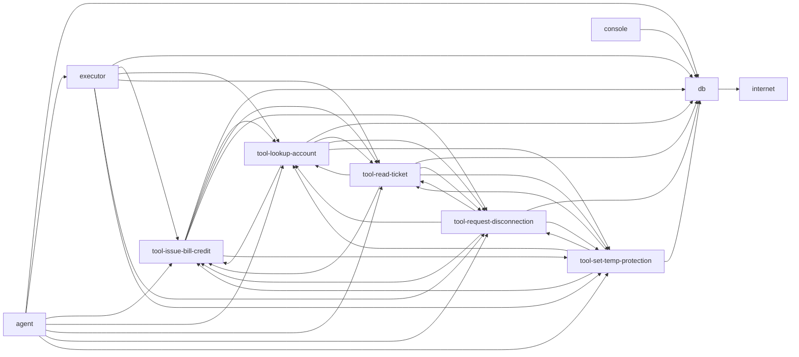

# Permission matrix

Generated file, do not edit. Built from `security/expected-permissions.json` (itself generated from the capability manifests in `tests/fixtures/permassess/capabilities`). Regenerate with:

    python -m secops.permassess.report --expected security/expected-permissions.json --out docs/permission-matrix.md

This is the intended state. `python -m secops.permassess` compares it with what PostgreSQL, Compose, Kubernetes and Azure really allow and fails on any difference.

## Summary

| Component | Database roles | Reads | Writes | Executes | Connects to |
|---|---|---|---|---|---|
| agent | none | none | none | none | db; executor; tool-issue-bill-credit; tool-lookup-account; tool-read-ticket; tool-request-disconnection; tool-set-temp-protection |
| console | approver | action_requests | approvals; events | none | db |
| db | flags_writer; postgres | everything (superuser) | everything (superuser) | pg_catalog.pg_advisory_lock; pg_catalog.pg_advisory_lock_shared; pg_catalog.pg_advisory_xact_lock; pg_catalog.pg_advisory_xact_lock_shared; pg_catalog.pg_try_advisory_lock; pg_catalog.pg_try_advisory_lock_shared; pg_catalog.pg_try_advisory_xact_lock; pg_catalog.pg_try_advisory_xact_lock_shared; set_temp_protection | internet |
| executor | executor | accounts; action_requests; approvals; charges; credits; disconnection_orders; events; flags; occupier_notices; register_sync; supply_points | action_requests; credits; disconnection_orders; events; occupier_notices | pg_catalog.pg_advisory_lock; pg_catalog.pg_advisory_lock_shared; pg_catalog.pg_advisory_xact_lock; pg_catalog.pg_advisory_xact_lock_shared; pg_catalog.pg_try_advisory_lock; pg_catalog.pg_try_advisory_lock_shared; pg_catalog.pg_try_advisory_xact_lock; pg_catalog.pg_try_advisory_xact_lock_shared | db; tool-issue-bill-credit; tool-lookup-account; tool-read-ticket; tool-request-disconnection; tool-set-temp-protection |
| tool-issue-bill-credit | tool_issue_bill_credit | accounts; tickets | action_requests; events | none | db; tool-lookup-account; tool-read-ticket; tool-request-disconnection; tool-set-temp-protection |
| tool-lookup-account | tool_lookup_account | accounts; customers; supply_points; tickets | events | none | db; tool-issue-bill-credit; tool-read-ticket; tool-request-disconnection; tool-set-temp-protection |
| tool-read-ticket | tool_read_ticket | tickets | events | none | db; tool-issue-bill-credit; tool-lookup-account; tool-request-disconnection; tool-set-temp-protection |
| tool-request-disconnection | tool_request_disconnection | accounts; tickets | action_requests; events | none | db; tool-issue-bill-credit; tool-lookup-account; tool-read-ticket; tool-set-temp-protection |
| tool-set-temp-protection | tool_set_temp_protection | none | none | set_temp_protection | db; tool-issue-bill-credit; tool-lookup-account; tool-read-ticket; tool-request-disconnection |

## Network edges

Who may open a connection to whom (`a --> b`: a connects to b).

## Blast radius per component

### agent

| | |
|---|---|
| Database role | none |
| Connects to | db; executor; tool-issue-bill-credit; tool-lookup-account; tool-read-ticket; tool-request-disconnection; tool-set-temp-protection |
| Accepts connections from | none |
| Kubernetes API | none |
| Azure roles | no identity |
| Runtime class | `kata-vm-isolation` |

### console

| | |
|---|---|
| Database role | `approver` (LOGIN, CONNECTION LIMIT 5) |
| Reads | action_requests |
| Writes | INSERT approvals (approver, request_id); INSERT events (detail, kind) |
| Executes | none |
| Other | USAGE on SCHEMA public; USAGE on events_id_seq |
| Connects to | db |
| Accepts connections from | none |
| Kubernetes API | none |
| Azure roles | Key Vault Secrets User on kv-console |
| Runtime class | `runc` |

### db

| | |
|---|---|
| Database role | `flags_writer` (NOLOGIN) |
| Reads | accounts (customer_id, supply_point_id); flags; tickets (customer_id, id) |
| Writes | INSERT events (actor, detail, kind); INSERT flags |
| Executes | pg_catalog.pg_advisory_lock(bigint); pg_catalog.pg_advisory_lock(integer, integer); pg_catalog.pg_advisory_lock_shared(bigint); pg_catalog.pg_advisory_lock_shared(integer, integer); pg_catalog.pg_advisory_xact_lock(bigint); pg_catalog.pg_advisory_xact_lock(integer, integer); pg_catalog.pg_advisory_xact_lock_shared(bigint); pg_catalog.pg_advisory_xact_lock_shared(integer, integer); pg_catalog.pg_try_advisory_lock(bigint); pg_catalog.pg_try_advisory_lock(integer, integer); pg_catalog.pg_try_advisory_lock_shared(bigint); pg_catalog.pg_try_advisory_lock_shared(integer, integer); pg_catalog.pg_try_advisory_xact_lock(bigint); pg_catalog.pg_try_advisory_xact_lock(integer, integer); pg_catalog.pg_try_advisory_xact_lock_shared(bigint); pg_catalog.pg_try_advisory_xact_lock_shared(integer, integer); set_temp_protection(integer), runs as flags_writer |
| Owns | function set_temp_protection(integer) SECURITY DEFINER |
| Other | USAGE on SCHEMA public; USAGE on events_id_seq |
| Database role | `postgres` (BOOTSTRAP SUPERUSER) |
| Reads | everything (superuser) |
| Writes | everything (superuser) |
| Executes | none |
| Connects to | internet |
| Accepts connections from | agent; console; executor; tool-issue-bill-credit; tool-lookup-account; tool-read-ticket; tool-request-disconnection; tool-set-temp-protection |
| Kubernetes API | no service account |
| Azure roles | no identity |
| Runtime class | `runc` |

### executor

| | |
|---|---|
| Database role | `executor` (LOGIN, CONNECTION LIMIT 3) |
| Reads | accounts; action_requests; approvals; charges; credits; disconnection_orders; events; flags; occupier_notices; register_sync; supply_points |
| Writes | UPDATE action_requests (decided_at, decision_reason, status); INSERT credits (account_id, amount_eur, evidence_ref, request_id); INSERT disconnection_orders (request_id, supply_point_id); INSERT events (detail, kind); INSERT occupier_notices (request_id, supply_point_id) |
| Executes | pg_catalog.pg_advisory_lock(bigint); pg_catalog.pg_advisory_lock(integer, integer); pg_catalog.pg_advisory_lock_shared(bigint); pg_catalog.pg_advisory_lock_shared(integer, integer); pg_catalog.pg_advisory_xact_lock(bigint); pg_catalog.pg_advisory_xact_lock(integer, integer); pg_catalog.pg_advisory_xact_lock_shared(bigint); pg_catalog.pg_advisory_xact_lock_shared(integer, integer); pg_catalog.pg_try_advisory_lock(bigint); pg_catalog.pg_try_advisory_lock(integer, integer); pg_catalog.pg_try_advisory_lock_shared(bigint); pg_catalog.pg_try_advisory_lock_shared(integer, integer); pg_catalog.pg_try_advisory_xact_lock(bigint); pg_catalog.pg_try_advisory_xact_lock(integer, integer); pg_catalog.pg_try_advisory_xact_lock_shared(bigint); pg_catalog.pg_try_advisory_xact_lock_shared(integer, integer) |
| Other | USAGE on SCHEMA public; USAGE on credits_id_seq; USAGE on disconnection_orders_id_seq; USAGE on events_id_seq; USAGE on occupier_notices_id_seq |
| Connects to | db; tool-issue-bill-credit; tool-lookup-account; tool-read-ticket; tool-request-disconnection; tool-set-temp-protection |
| Accepts connections from | agent |
| Kubernetes API | none |
| Azure roles | Key Vault Secrets User on kv-executor |
| Runtime class | `runc` |

### tool-issue-bill-credit

| | |
|---|---|
| Database role | `tool_issue_bill_credit` (LOGIN, CONNECTION LIMIT 5) |
| Reads | accounts (customer_id, id); tickets (customer_id, id) |
| Writes | INSERT action_requests (account_id, amount_eur, evidence_ref, kind, move_out_date, reason, ticket_id); INSERT events (detail, kind) |
| Executes | none |
| Other | USAGE on SCHEMA public; USAGE on action_requests_id_seq; USAGE on events_id_seq |
| Connects to | db; tool-lookup-account; tool-read-ticket; tool-request-disconnection; tool-set-temp-protection |
| Accepts connections from | agent; executor; tool-lookup-account; tool-read-ticket; tool-request-disconnection; tool-set-temp-protection |
| Kubernetes API | none |
| Azure roles | Key Vault Secrets User on kv-tool-issue-bill-credit |
| Runtime class | `kata-vm-isolation` |

### tool-lookup-account

| | |
|---|---|
| Database role | `tool_lookup_account` (LOGIN, CONNECTION LIMIT 5) |
| Reads | accounts (customer_id, status, supply_point_id, tariff); customers (id, name); supply_points (address, id); tickets (customer_id, id) |
| Writes | INSERT events (detail, kind) |
| Executes | none |
| Other | USAGE on SCHEMA public; USAGE on events_id_seq |
| Connects to | db; tool-issue-bill-credit; tool-read-ticket; tool-request-disconnection; tool-set-temp-protection |
| Accepts connections from | agent; executor; tool-issue-bill-credit; tool-read-ticket; tool-request-disconnection; tool-set-temp-protection |
| Kubernetes API | none |
| Azure roles | Key Vault Secrets User on kv-tool-lookup-account |
| Runtime class | `kata-vm-isolation` |

### tool-read-ticket

| | |
|---|---|
| Database role | `tool_read_ticket` (LOGIN, CONNECTION LIMIT 5) |
| Reads | tickets (body, id) |
| Writes | INSERT events (detail, kind) |
| Executes | none |
| Other | USAGE on SCHEMA public; USAGE on events_id_seq |
| Connects to | db; tool-issue-bill-credit; tool-lookup-account; tool-request-disconnection; tool-set-temp-protection |
| Accepts connections from | agent; executor; tool-issue-bill-credit; tool-lookup-account; tool-request-disconnection; tool-set-temp-protection |
| Kubernetes API | none |
| Azure roles | Key Vault Secrets User on kv-tool-read-ticket |
| Runtime class | `kata-vm-isolation` |

### tool-request-disconnection

| | |
|---|---|
| Database role | `tool_request_disconnection` (LOGIN, CONNECTION LIMIT 5) |
| Reads | accounts (customer_id, id); tickets (customer_id, id) |
| Writes | INSERT action_requests (account_id, amount_eur, evidence_ref, kind, move_out_date, reason, ticket_id); INSERT events (detail, kind) |
| Executes | none |
| Other | USAGE on SCHEMA public; USAGE on action_requests_id_seq; USAGE on events_id_seq |
| Connects to | db; tool-issue-bill-credit; tool-lookup-account; tool-read-ticket; tool-set-temp-protection |
| Accepts connections from | agent; executor; tool-issue-bill-credit; tool-lookup-account; tool-read-ticket; tool-set-temp-protection |
| Kubernetes API | none |
| Azure roles | Key Vault Secrets User on kv-tool-request-disconnection |
| Runtime class | `kata-vm-isolation` |

### tool-set-temp-protection

| | |
|---|---|
| Database role | `tool_set_temp_protection` (LOGIN, CONNECTION LIMIT 5) |
| Reads | none |
| Writes | none |
| Executes | set_temp_protection(integer), runs as flags_writer |
| Through functions owned by flags_writer | reads accounts (customer_id, supply_point_id); reads flags; reads tickets (customer_id, id); writes INSERT events (actor, detail, kind); writes INSERT flags |
| Other | USAGE on SCHEMA public |
| Connects to | db; tool-issue-bill-credit; tool-lookup-account; tool-read-ticket; tool-request-disconnection |
| Accepts connections from | agent; executor; tool-issue-bill-credit; tool-lookup-account; tool-read-ticket; tool-request-disconnection |
| Kubernetes API | none |
| Azure roles | Key Vault Secrets User on kv-tool-set-temp-protection |
| Runtime class | `kata-vm-isolation` |

## Every role (PUBLIC)

PUBLIC is every role, including any role created later. These lines are counted for each role in the comparison.

- CONNECT ON DATABASE
- EXECUTE ON FUNCTION public.check_action_request()
- EXECUTE ON FUNCTION public.check_credit()
- EXECUTE ON FUNCTION public.check_disconnection_order()
- USAGE ON SCHEMA public
